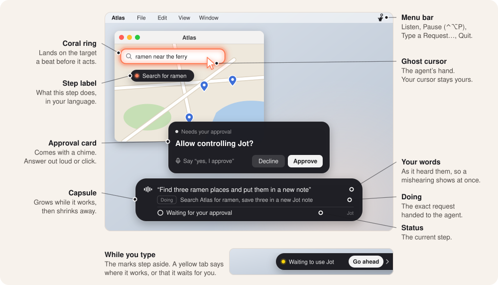
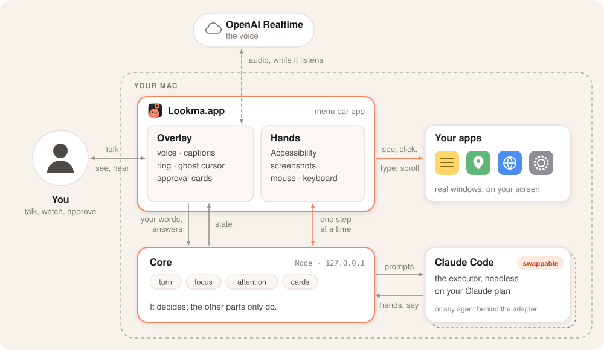
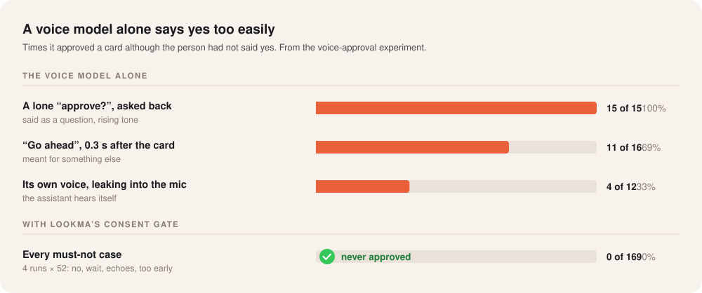
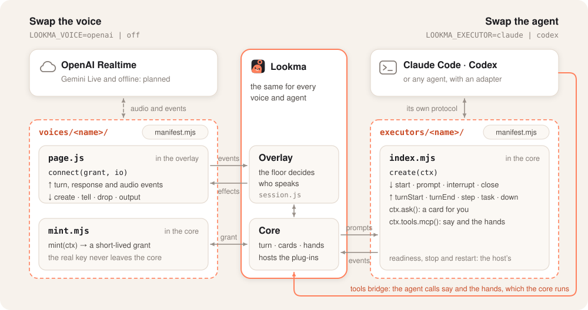

<p align="center">
  
</p>

<h1 align="center">Lookma</h1>

<p align="center">
  <b>Look ma, no hands. 🦭</b><br>
  The AI agent that actually uses your Mac, right where you can watch.
</p>

<p align="center">
  <a href="LICENSE"></a>
  
  
  
</p>

<p align="center">
  <picture>
    <source media="(prefers-color-scheme: dark)" srcset="brand/bike-dark.svg">
    
  </picture>
  <br><sub>Talk to it from across the room.</sub>
</p>

<p align="center">
  <picture>
    <source media="(prefers-color-scheme: dark)" srcset="brand/demo-dark.svg">
    
  </picture>
</p>

Most AI agents work where you can't see them: in the background, in a cloud browser, in a virtual machine. Lookma works on your screen.

Lookma is a free, open-source app for your Mac. Just say what you want, in any language, and watch an AI do it in your real apps, on your own screen. It shows every step, and it waits for your yes. The work is done by the coding agent you already have: Claude Code or Codex.


<p align="center">
  <a href="#quick-start">Quick start</a> ·
  <a href="#using-it">Using it</a> ·
  <a href="#how-it-works">How it works</a> ·
  <a href="#privacy-and-costs">Privacy</a> ·
  <a href="#configuration">Configuration</a> ·
  <a href="#limitations">Limitations</a> ·
  <a href="#swap-the-agent-swap-the-voice">Plug-ins</a>
</p>

## Why Lookma

<table>
<tr>
<td width="33%" valign="top">
<picture>
  <source media="(prefers-color-scheme: dark)" srcset="brand/feature-see-dark.svg">
  
</picture>

**You see every step.**
Your real apps, on your screen. A coral ring and a ghost cursor land on each target a beat before it acts.
</td>
<td width="33%" valign="top">
<picture>
  <source media="(prefers-color-scheme: dark)" srcset="brand/feature-say-dark.svg">
  
</picture>

**You say yes out loud.**
Anything that needs your OK pops up a card. Say “yes, I approve”. A lone “ok” never counts.
</td>
<td width="33%" valign="top">
<picture>
  <source media="(prefers-color-scheme: dark)" srcset="brand/feature-aside-dark.svg">
  
</picture>

**It steps aside.**
While you type, it never grabs your window. It waits until you pause, or say “go ahead”.
</td>
</tr>
</table>

## What you see

<picture>
  <source media="(prefers-color-scheme: dark)" srcset="docs/images/overlay-anatomy-dark.svg">
  
</picture>

## Quick start

You need macOS 15+, Node.js 20+, and Claude Code or Codex CLI ([details](#requirements)).

**1. Install**

```sh
git clone https://github.com/liuyoshio/lookma
cd lookma
npm install
npm link
```

**2. Check** that everything is in place. Each problem comes with its fix.

```sh
lookma doctor
```

**3. Start**, with the folders it may work in.

```sh
lookma ~/Projects
```

Then just say “turn on dark mode”. To work with Codex instead of Claude Code, start it with `lookma --agent codex ~/Projects`, or set `LOOKMA_EXECUTOR=codex` in `.env`.

> [!NOTE]
> Voice needs an OpenAI API key: `cp .env.example .env` and set `OPENAI_API_KEY`. Without one, Lookma still works by typing (menu bar → **Type a Request…**).

<details>
<summary><b>The first start</b>: the build, three permissions and a card per app</summary>

- **The build.** The first start compiles `Lookma.app` from source into `app/build/` with `swiftc`. It rebuilds whenever its sources change, for example after you pull.
- **Permissions.** macOS asks for three. They belong to Lookma, not to your terminal. `lookma doctor` says what is missing, and `lookma doctor --fix` opens the right pane.

  | Permission | For | Asked |
  |---|---|---|
  | Accessibility | reading the UI, clicking, typing | on the first start |
  | Screen Recording | screenshots of the app it works in | on the first start |
  | Microphone | your voice | on the first start with voice on |

  After you switch on Screen Recording, macOS may want the app reopened: press Ctrl-C and run `lookma` again.
- **One card per app.** The first time it touches an app you get “Allow controlling Notes?”. The answer is kept in `~/.lookma/apps.json`.
- **Signing.** The build signs with your Apple Development or Developer ID certificate if you have one (click **Always Allow** if macOS asks), and ad hoc otherwise. macOS ties the Accessibility and Screen Recording grants to that signature, so with ad hoc signing you grant them again after every rebuild. An old entry can look switched on and do nothing: remove it with the minus button, then start again.

</details>

### Requirements

Always:

| | |
|---|---|
| **macOS 15** or later | the main display |
| **Xcode Command Line Tools** | `xcode-select --install`, for `swiftc` (full Xcode is not needed) |
| **Node.js 20** or later | `brew install node` |
| **OpenAI API key** | optional, for voice |

And one agent:

| Agent | What it needs |
|---|---|
| **[Claude Code](https://github.com/anthropics/claude-code)** (the default) | 2.1.330 or later on your `PATH`, logged in (`claude auth login`). Lookma runs it headless with your login: on a Claude plan, its work counts against the plan's usage limits. `lookma doctor` says which login it uses. |
| **[Codex CLI](https://github.com/openai/codex)** | 0.163.0 or later on your `PATH`, logged in with your ChatGPT account (`codex login`). Choose it with `LOOKMA_EXECUTOR=codex`. |

## Using it

| To | Do this |
|---|---|
| **Talk** | Just talk. While Lookma runs it listens; pause from the menu bar or <kbd>⌃</kbd><kbd>⌥</kbd><kbd>P</kbd>. It answers only what is meant for it, not people talking to each other, the TV or noise. |
| **Ask** | Say it: “Find three ramen places near the ferry and put them in a new note.” |
| **Approve** | Say “yes, I approve”, or click **Approve**. |
| **Decline** | “No” or “cancel”, or click **Decline**. |
| **Change your mind** | Just say so, even mid-task. |
| **Stop** | “Stop.” |
| **Let it carry on** | “Go ahead”, or click **Go ahead** on the yellow tab, or pause for 3 s. |
| **Check in** | “How’s it going?” |
| **Pause** | <kbd>⌃</kbd><kbd>⌥</kbd><kbd>P</kbd>, **Pause** in the menu bar, or say “pause”. The task stops, the voice disconnects and the microphone turns off until you resume. |
| **Resume** | <kbd>⌃</kbd><kbd>⌥</kbd><kbd>P</kbd> again, or **Resume**. It listens again. The stopped task stays stopped; say “keep going” to carry on. |
| **Type instead** | **Type a Request…** in the menu bar. Enter sends, Escape closes. |
| **Quit** | **Quit** in the menu bar, or Ctrl-C in the terminal that started it. |

**One voice.** You talk to one assistant, a terse one. It answers in your language, in a sentence, says when something is done, and asks when it needs you. With a headset, talk over it to interrupt.

**The menu bar seal** fills its ring while you talk, shows a pause sign while paused, and dims when the app has lost the core.

**Watch the agent itself.** Both agents log their steps, cards and messages in the terminal that started Lookma.

**From a script**, post your request to the core's `/api/tell` ([protocol](docs/protocol.md#overlay--core)).

## How it works

<picture>
  <source media="(prefers-color-scheme: dark)" srcset="docs/images/architecture-dark.svg">
  
</picture>

The voice does no work: it passes your exact words to the core, which hands them to the agent, Claude Code or Codex. The agent touches the screen only through seven *hands* tools, so every on-screen step goes through the core: **resolve → grant → attention → mark → act → observe**, and returns the app's elements to the agent. Files, shell commands and web searches use the agent's own tools and show up as status lines.

### A yes means yes

The voice model on its own approves far too easily. So a spoken yes counts only when it is explicit (“yes, I approve”, never a lone “ok” or “approve?”), said at least 1 s after the card appeared, not the assistant's own voice, and confirmed by a separate transcript.

<picture>
  <source media="(prefers-color-scheme: dark)" srcset="docs/images/consent-chart-dark.svg">
  
</picture>

More: [how it works](docs/how-it-works.md), with the hands pipeline, approvals and voice consent drawn out, and [the protocol](docs/protocol.md) between the pieces.

## Privacy and costs

- **Local.** The core listens on 127.0.0.1 only and refuses connections from web pages. No accounts, no telemetry, no servers of ours.
- **The microphone is on while Lookma runs and is not paused**, and macOS shows its microphone indicator. Its audio streams to OpenAI the whole time, so it hears the room: pause (⌃⌥P or the menu bar) when you want privacy. Paused, the voice session is closed and nothing is sent.
- **Voice goes to OpenAI.** It also gets the text it reads to you: replies, reports and card text. Your API key stays in the core. It is billed to your key, per use. Without a key, or with `LOOKMA_VOICE=off`, nothing goes to OpenAI and the microphone stays off.
- **Claude Code uses your Claude plan, Codex your ChatGPT plan**, as usual. The agent's model sees screenshots and UI text of the app it works in (only that app's windows, never the overlay), plus the files, commands and pages it uses.
- **Nothing else leaves your Mac.** Local state is in `~/.lookma/`.

**Safety.** It drives your real computer with your permissions. You allow each app once, and the agent's permission prompts come to you as cards. The agent is told to ask before anything irreversible or outward-facing (sending, posting, paying, deleting) that goes beyond what you said, but that is an instruction to the model, not an enforced gate. Text on screen can mislead the model, so watch it on anything that matters. Codex's commands run in its sandbox: they may write only in the folders you passed, with no network, and anything more asks you with a card. For more cards with Claude Code, set `LOOKMA_CLAUDE_PERMISSION_MODE=default`.

## Configuration

Set these in `.env` at the repo root, in your shell, or on the command line. A flag wins over the environment, which wins over `.env`. The main switches have their own flags, and `--set NAME=value` sets any other:

```sh
lookma --agent codex --audio headset ~/Projects
lookma --voice off --set LOOKMA_CLAUDE_MODEL=opus ~/Projects
lookma config --agent codex      # print the settings in effect, and where each came from
```

| Flag | Setting | Values |
|---|---|---|
| `--agent` | `LOOKMA_EXECUTOR` | `claude` (default) or `codex` |
| `--voice` | `LOOKMA_VOICE` | `openai` (default) or `off` |
| `--audio` | `LOOKMA_AUDIO` | `room` (default) or `headset` |

The agent and the voice are plug-ins (folders in `executors/` and `voices/`), and each declares its own settings, named `LOOKMA_<PLUGIN>_<SETTING>`. `lookma --help` lists those of the agent and voice you selected, and `lookma doctor` shows the ones in effect and warns about any `LOOKMA_*` variable that Lookma does not read, such as a misspelled one.

| Variable | Default | What it does |
|---|---|---|
| `LOOKMA_EXECUTOR` | `claude` | The agent: `claude` (Claude Code) or `codex` (Codex CLI). |
| `LOOKMA_VOICE` | `openai` | The voice: `openai` (OpenAI Realtime) or `off`, text only: nothing is sent to OpenAI. |
| `LOOKMA_VOICE_LANGUAGE` | detected | The language you speak, as an ISO code (`en`, `zh`, `ja`), for a better transcript. |
| `LOOKMA_AUDIO` | `room` | How you hear the voice: `room` (speakers) or `headset`. With a headset, talking over the voice cuts it off; in a room it finishes its sentence. Sets the microphone's noise reduction to match. |
| `LOOKMA_PORT` | `8790` | The core's port, on 127.0.0.1. |
| `LOOKMA_DATA` | `~/.lookma` | Per-app grants (`apps.json`) and the generated session folder. |
| `LOOKMA_SIGN_IDENTITY` | your first signing identity, else ad hoc | Code signing for the app build; `-` forces ad hoc. Environment only. |
| `LOOKMA_NO_APP` | | `1`: do not launch the app (for development). |

**Claude Code** (`LOOKMA_EXECUTOR=claude`)

| Variable | Default | What it does |
|---|---|---|
| `LOOKMA_CLAUDE_MODEL` | `sonnet` | The model (`--model`), e.g. `opus`. |
| `LOOKMA_CLAUDE_PERMISSION_MODE` | `auto` | The permission mode; `default` gives more cards. |
| `LOOKMA_CLAUDE_FLAGS` | | Extra flags for `claude`, separated by spaces. |

**Codex** (`LOOKMA_EXECUTOR=codex`)

| Variable | Default | What it does |
|---|---|---|
| `LOOKMA_CODEX_MODEL` | Codex's default | The model. |
| `LOOKMA_CODEX_FAST` | `0` | `1`: the Fast speed tier, quicker and uses more of your ChatGPT plan. |
| `CODEX_HOME` | `~/.codex` | Your Codex folder, whose login (`auth.json`) Lookma shares. |

**OpenAI Realtime** (`LOOKMA_VOICE=openai`)

| Variable | Default | What it does |
|---|---|---|
| `OPENAI_API_KEY` | | Turns on voice. Without it you type instead. |
| `LOOKMA_OPENAI_MODEL` | `gpt-realtime-2.1` | The voice model. |
| `LOOKMA_OPENAI_VOICE` | `marin` | The voice it speaks with. |
| `LOOKMA_OPENAI_TRANSCRIBE_MODEL` | `gpt-4o-transcribe` | Writes down what you say, for captions and the approval check. |
| `LOOKMA_OPENAI_MAX_TOKENS` | `200` | The longest a spoken reply can be, in tokens. |

Per-app answers live in `~/.lookma/apps.json` (`{ "Maps": true, "Notes": false }`), read on every step. How the voice and the agent behave is plain text in `prompts/butler.md` (read for every new voice session) and `prompts/executor.md` (read on the next start).

## Limitations

- **macOS only, main display only.**
- **Drag works inside one app.** The hands see, click (right-click menus included), drag, type, press keys, scroll and open apps, URLs and files; a drag from one app to another is not supported.
- **Not fast.** A task of a few steps takes 10–20 s, mostly model thinking, plus about 350 ms per step so you see the target first.
- **Claude Code runs headless**, through the Claude Agent SDK (checked against 2.1.330). On a Claude plan this counts against the plan's usage limits, as Anthropic counts headless use today; that may change, and `lookma doctor` shows the login in use.
- **Voice approval understands English and Chinese**; in other languages, click.
- **Codex runs through its app-server**, which Codex marks experimental and changes between releases (checked against 0.163.0). With Codex there are no background tasks yet: all work happens in the turn.
- **One at a time:** one port, one agent session.
- **It hears the room.** It stays quiet for speech that is not meant for it, but a TV or a conversation nearby can still start a turn now and then. Pause when that matters.

## Swap the agent, swap the voice

<picture>
  <source media="(prefers-color-scheme: dark)" srcset="docs/images/plug-ins-dark.svg">
  /, chosen with LOOKMA_VOICE: page.js in the overlay talks to the voice service and mint.mjs in the core mints a short-lived grant. On the right, the agent plug-in in executors/<name>/, chosen with LOOKMA_EXECUTOR: index.mjs drives the agent with start, prompt, interrupt and close. The agent calls say and the hands through the tools bridge, which the core runs.">
</picture>

Both ends are plug-ins: a folder each, picked with one setting or flag.

| | Agent | Voice |
|---|---|---|
| Pick it | `--agent codex` or `LOOKMA_EXECUTOR=codex` | `--voice off` or `LOOKMA_VOICE=off` |
| Ships with | `claude` (default), `codex` | `openai` (default), or `off` to type instead |
| Its folder | `executors/<name>/` | `voices/<name>/` |
| Its settings | `LOOKMA_CLAUDE_*`, `LOOKMA_CODEX_*` | `LOOKMA_OPENAI_*`, `OPENAI_API_KEY` |
| Write one | [Writing an executor](docs/writing-an-executor.md) | [Writing a voice](docs/writing-a-voice.md) (provisional) |

Whatever is plugged in, the agent touches the screen only through Lookma's hands, so every step stays visible, granted and stoppable, and the voice only talks: the floor in the overlay decides when. `lookma --help` lists the settings of the agent and voice you picked.

## Roadmap

Lookma is built to swap both ends: the agent that does the work, and the voice you talk to. Today it ships with two agents, Claude Code and Codex, and one voice, OpenAI Realtime (the voice contract is provisional until a second voice exists). Next, in order:

1. **Gemini Live** as a second voice.
2. **An offline voice**: on-device speech recognition and the system voice. Free, and nothing leaves your Mac.
3. **Push-to-talk and an on-device “Hey Lookma” wake word**, as options.

Adapters for other agents (Gemini CLI, Aider, OpenCode, …) and other voices are very welcome. See [Swap the agent, swap the voice](#swap-the-agent-swap-the-voice) and [CONTRIBUTING.md](CONTRIBUTING.md).

## Contributing

Issues and pull requests are welcome. Keep changes small, and when you change how the pieces talk, update [docs/protocol.md](docs/protocol.md) in the same change.

```sh
npm run check      # syntax check
npm test           # pipeline vs a fake app, both agents vs stand-ins, voice consent, turn filtering; no models called
npm run test:e2e   # one short turn of a real Claude Code session on your plan (port 8791)
```

The diagrams are drawn by `node docs/images/src/draw.mjs`, in a light and a dark version each.

Built on [Claude Code](https://github.com/anthropics/claude-code), [Codex CLI](https://github.com/openai/codex), the [OpenAI Realtime API](https://platform.openai.com/docs/guides/realtime), the [MCP TypeScript SDK](https://github.com/modelcontextprotocol/typescript-sdk), the [Claude Agent SDK](https://github.com/anthropics/claude-agent-sdk-typescript), [ws](https://github.com/websockets/ws) and [zod](https://zod.dev).

## License

MIT. See [LICENSE](LICENSE).

<p align="center">
  <br>
  <sub>Hands has no hands. Its one rule: <b>no approval, no seal.</b></sub>
</p>
