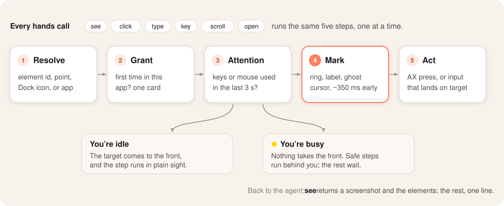
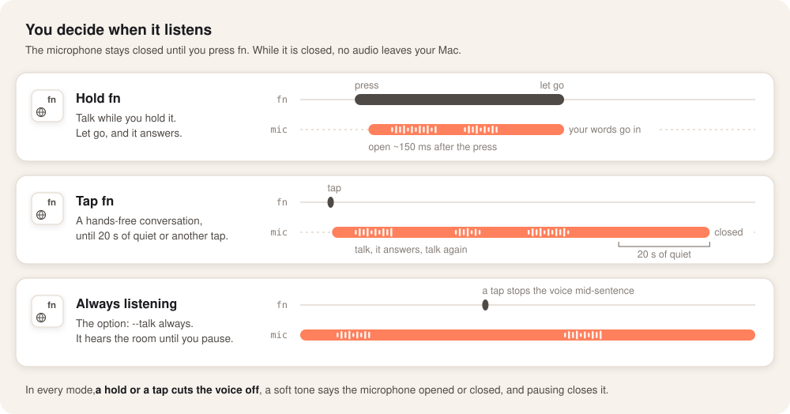

# How Lookma works

Lookma keeps one small model of what is going on:

- **the turn**: one request from you and everything it leads to;
- **the focus**: the target the agent is acting on right now, an app plus a rect and a point;
- **your attention**: whether you are using the keyboard or mouse.

Every step is visible by default. The overlay draws only what follows from those three.

This page explains the design. The exact messages are in [protocol.md](protocol.md), the contract between the pieces.

## The pieces

<picture>
  <source media="(prefers-color-scheme: dark)" srcset="images/architecture-dark.svg">
  
</picture>

| Piece | Where | What it does |
|---|---|---|
| Core | `core/` | A resident Node process on 127.0.0.1:8790. The only piece that decides anything: it holds the turn, focus, attention and approval cards, runs the hands pipeline and grants the voice its sessions. |
| App | `app/` | `Lookma.app`, a small Swift menu bar app with no Dock icon. It provides primitives and decides nothing: Accessibility (AX) reads and presses, screenshots, keyboard and mouse input, seconds since your last input, the fn key's edges, hand gestures from the camera (opt-in), and the overlay window. macOS permissions belong to it, so the core launches it with `open`. |
| Overlay | `overlay/` | A web page in the app's full-screen, transparent, click-through window. It draws the capsule, marks, cards and your hand's dot, and runs the voice. The window takes clicks only on the card, the Go ahead button and the text box. |
| Executor adapter | `executors/<name>/` | Wraps one agent behind the executor contract: `claude`, Claude Code run headless through the Claude Agent SDK, or `codex`, Codex CLI through its app-server. Its `manifest.mjs` declares its settings and checks. |
| Voice provider | `voices/<name>/` | The voice service, today `openai` (OpenAI Realtime). Its `manifest.mjs` declares its settings, `mint.mjs` runs in the core and mints a short-lived grant for each session, and `page.js` runs in the overlay and connects to the service. The rest of the voice (`overlay/voice/`) is the same for every provider. |
| Prompts | `prompts/` | `butler.md` and `butler-tools.json` for the voice, `executor.md` for the agent. |
| Launcher | `bin/lookma`, `core/cli.mjs` | `bin/lookma` only finds Node and runs `core/cli.mjs`, which checks dependencies, builds the app when its sources changed (`core/app-build.mjs`), and starts the core. `lookma doctor` checks dependencies, permissions and what else the fn (🌐) key does. |

## Two plug-ins

<picture>
  <source media="(prefers-color-scheme: dark)" srcset="images/plug-ins-dark.svg">
  /, chosen with LOOKMA_VOICE: page.js in the overlay connects to the voice service, emits voice events and carries out the effects the floor and the turn source ask for, and mint.mjs in the core mints a short-lived grant. On the right, the agent plug-in in executors/<name>/, chosen with LOOKMA_EXECUTOR: index.mjs drives the agent with start, prompt, interrupt and close, and reports turnStart, turnEnd, step, task and down. The agent calls say and the hands through the tools bridge, which the core runs.">
</picture>

Both ends of Lookma can be swapped: the agent that does the work and the voice you talk to. Each is one folder with a `manifest.mjs` that says what it needs, behind a small contract, and a host in the core is the only code that loads it. Nothing else knows which one is plugged in.

- **The agent** (`executors/<name>/`, `LOOKMA_EXECUTOR`) is a driver for one agent session. Prompts and an interrupt go down; the agent's activity comes up as five events. The agent gets `say` and the hands from Lookma's tools bridge, so every step on screen still goes through the core. The executor host owns readiness, the order of prompts, the stop gate and one restart, the same for every agent.
- **The voice** (`voices/<name>/`, `LOOKMA_VOICE`) is one voice service in the floor's own terms. Its `page.js` in the overlay turns what the service sends into voice events and carries out six effects; its `mint.mjs` in the core mints a short-lived grant per session, so your API key stays in the core. The floor decides who speaks, the turn source when the microphone is open, and the session keeps the connection healthy, the same for every voice.

What a plug-in cannot do is never declared. An agent without background work simply never reports a task; a voice service that cannot, say, delete a conversation item does the nearest safe thing, and rules the floor already has absorb the difference.

[Writing an executor](writing-an-executor.md) and [Writing a voice](writing-a-voice.md) walk through adding one; [protocol.md](protocol.md#plug-ins) has the exact contracts.

## A turn, end to end

Say “find three ramen places near the ferry and put them in a new note”:

1. **You talk.** Hold fn, say it and let go, or tap fn first and just talk. While it listens, the overlay streams your microphone to the voice (OpenAI Realtime today); the turn ends when you let go or, hands-free, when the voice hears you stop. The voice starts the work with its `do` tool, keeping your names, numbers and dates; to you it is one assistant doing the work. The capsule shows what it heard and the exact text sent, so a mishearing shows at once.
2. **The core starts a turn** and hands the text to the executor. If a turn is already running, the text goes in as a correction instead: the agent takes it into the work it is doing.
3. **The agent works.** Anything on screen goes through the seven hands tools. Anything else (files, shell commands, web searches) uses the agent's own tools; the adapter reports each step, which shows up as the capsule's status line.
4. **Every hands call runs the pipeline** below, one call at a time.
5. **The agent talks back** with `say`: one short sentence in your language. You hear one assistant: the voice speaks it as soon as nobody is talking, on the same session. Questions, confirmations and approval cards go to the front of the queue. Without voice, these are captions only.
6. **The turn ends** when the agent stops. The capsule shows the result and how long it took, then shrinks away.

## The hands pipeline

<picture>
  <source media="(prefers-color-scheme: dark)" srcset="images/hands-pipeline-dark.svg">
  
</picture>

The agent's GUI tools are `see`, `click`, `drag`, `type`, `key`, `scroll` and `open`. Each call carries a `label`, a few words in your language (“Search for ramen”), which the overlay shows at the target. Every call goes through the same steps, in `core/hands.mjs`:

1. **Resolve** the target to an app, a rect and a point:
   - an element id from the latest list. An id stays valid while its element is listed, so two calls sent from one list both work; an id of an element that is gone is an error.
   - a point in the last screenshot's pixels. The app maps it back to screen points, and refuses it once that window has moved.
   - a Dock icon: opening an app means pressing its Dock icon, as a person would.
   - the app itself, for `see`, `type`, `key`, and `scroll` with no element or point.

   A `drag` has two targets, where it starts and where it drops, and both must be in the same app.
2. **Grant.** The first time the hands touch an app, the core raises its own card (“Allow controlling Maps?”). The answer is kept in `~/.lookma/apps.json`. A no ends the step with an error that the agent reads.
3. **Attention.** The app reports the seconds since your last key or mouse event every half second. You count as busy when you used either in the last 3 s.
   - **Not busy:** the target comes to the front.
   - **Busy:** nothing takes the front, the marks step aside, and a yellow tab at the screen edge says where it is working. What happens depends on the step:

   | Step | While you are busy |
   |---|---|
   | `see`, and `click` on an element that supports an AX press | Runs in the background. |
   | `type`, `key`, `scroll`, `open`, `drag`, a right `click`, and `click` at a point or on an element without an AX press | Waits until you pause for 3 s, or until you say “go ahead”. The tab says it is waiting. |

4. **Mark.** The core sets the focus. The overlay moves the coral ring to the target, hangs the label off it and flies the ghost cursor to the point. A drag also gets a dimmer ring on where it drops and a dashed line to it, so you see both ends before the button goes down. Before an action, the core waits about 350 ms so the marks arrive before anything happens. `see` only looks, so it does not wait.
5. **Act** through the app. Input that needs the front is posted only when it will land in the target: the point must be on the target's window, and the target must have keyboard focus. Otherwise the step fails with a reason. The app returns once the effect has had time to show (200 ms after the last event for a click, a drag, a key or text; for a right click, once its menu is up). A drag holds the button about 300 ms before it moves, as apps want, and the ghost cursor holds and glides with it.
6. **Observe.** The core lists the app the step resolved and granted. So the agent does not need a `see` after every action: act, read the list, act again. If listing fails after an action, the action is still reported as done. `open` with a URL or a file lists nothing, since the app it opened in has not been granted yet; the agent's next `see` asks.
7. **Return** to the agent: a line saying what was done, then a text list of elements (id, role, text, and states such as selected or disabled; an open menu's items first), headed by the facts that tell the agent whether the list is enough: whether it was cut short, how many elements have no label, and whether the last screenshot is older than this list. A screenshot comes only when the call asks for one (`screenshot: true`, on any tool): for a canvas, a map or unlabeled icons.

Screenshots contain only the target app's windows, its menus and popups included. The overlay and anything covering the app are left out. The long edge is at most 1280 px.

Saying “stop” aborts the step in flight and everything queued, and interrupts the agent: the Agent SDK's `interrupt()` for Claude Code, `turn/interrupt` for Codex.

## Approvals

<picture>
  <source media="(prefers-color-scheme: dark)" srcset="images/approvals-dark.svg">
  
</picture>

Everything that needs your OK is the same thing: one card, answered by voice or by click. Cards come from the core and from the agent:

| Source | Example | How the answer gets back |
|---|---|---|
| Core | “Allow controlling Maps?” | The waiting pipeline step continues, or fails. |
| Claude Code | A tool call its permission mode does not allow by itself, e.g. a command or a path outside the working folders | The answer to the Agent SDK's `canUseTool`. |
| app-server (Codex) | A command or file change that needs more than the sandbox allows | The reply to Codex's request. |

Each agent asks one request at a time, in a structured form, so a card maps to exactly one question and nothing is read off a screen. Approve always means “yes, this once”: Claude Code gets allow for that call, without the rule it suggests for later, and Codex gets `accept`, never `acceptForSession`. Decline answers deny or `decline`, and the agent goes on without that step. A card withdrawn by a stop answers the same as a decline. The card shows what the step would do (the command, the file, the page), never the agent's own options, so it cannot suggest that Approve might mean “always”.

## When it listens

<picture>
  <source media="(prefers-color-scheme: dark)" srcset="images/talking-dark.svg">
  
</picture>

The microphone is closed until you ask. **Hold fn** and it listens while you hold it: the turn is yours from the press to the release, and your words go in when you let go. **Tap fn**, or choose Start Conversation in the menu bar, and it listens hands-free until 20 s of quiet or another tap. Quiet means nobody speaking, nothing waiting to be said, no turn working and no card waiting, so a conversation stays open through the task it asked for and you answer “Done, shall I …?” without the key; background tasks do not count, since they can run for an hour. Any talk it hears, even talk not meant for it, starts the 20 s again. **Always listening** (`--talk always`, or Listen: Always in the menu for one run) is the option: it listens whenever Lookma runs and is not paused, as if a conversation were always open. Pause from the menu bar, with ⌃⌥P or by saying “pause”, and the voice is off until you resume.

**One model for all three.** The turn source (`overlay/voice/source.js`, a small pure reducer) answers one question: is the microphone open, and who ends the turn? It has three answers:

| `how` | Microphone | Who ends a turn |
|---|---|---|
| `off` | closed: nothing captured, nothing sent | nobody: there are no turns |
| `hold` | open | the key: the turn ends at release |
| `auto` | open | the voice service's detector |

The talk mode only picks where it rests: `key` (the default) rests `off`, `always` rests `auto`. Holding fn gives a `hold` turn in both, and in `key` a tap opens or closes a conversation, `auto`. Every hold and every tap first cuts the voice off, so the key is also how you interrupt it, with speakers as with a headset. The source tells the voice provider the level (`listen`) whenever it changes; nothing else opens or closes the microphone.

**Reading the key.** The app watches fn alone (`app/Sources/TalkKey.swift`) and passes its edges to the page: down, up, and cancel when any other key or modifier joins it. It only observes, never consumes, so fn keeps working as a modifier. A press means nothing until it has lasted 150 ms alone, so fn+arrow, fn+delete and Globe shortcuts open no microphone and cut nothing; released within 300 ms of the press, it was a tap. A hold ends by itself after 60 s, in case the release is lost: while a password field has focus, macOS Secure Input hides every key from every app.

**The 🌐 key.** fn is also the Globe key, which macOS may give a job of its own (System Settings → Keyboard → Press 🌐 key to): then a tap also switches the input source or opens Emoji & Symbols. `lookma doctor` and `lookma start` read that setting and ask for Do Nothing (⌃Space still switches input sources), and `lookma doctor --fix` opens the pane. Lookma never changes the setting itself.

**What you notice.** A soft rising tone once the microphone is live, a falling one when it closes. The capsule's bars are hollow while it is closed and solid while it is open, the menu bar seal fills its ring, and macOS shows its microphone indicator only while it is open. An approval card's hint reads “Hold fn and say ‘yes, I approve’” while the microphone is closed.

**One warm session.** The overlay (`overlay/voice.js`) keeps one session of the voice connected whether the microphone is open or not: with OpenAI Realtime, one WebRTC call whose audio sender carries no track while the microphone is closed, so no audio of any kind reaches the service. The voice speaks on the same session, so it can tell you something at any time, and it remembers the conversation from one turn to the next. Pausing closes the session; resuming opens a fresh one. With voice off (`LOOKMA_VOICE=off` or no OpenAI key) there is no session and no microphone.

**Turns.** While you hold fn the key bounds the turn: OpenAI's detector is switched off for the hold and the turn is committed when you let go. Hands-free, the voice service finds the turns: OpenAI's uses semantic voice activity detection, at medium eagerness, so a short pause to think does not cut you off. `LOOKMA_AUDIO` says how you hear the voice. In a `room` (the default) noise reduction is `far_field` and the voice finishes its sentence when you talk over it, since what it hears then may be its own echo; fn still cuts it off. With a `headset` it is `near_field` and your speech stops the voice at once. Either way a turn does not answer itself: the service never replies on its own, and the overlay's floor asks for every reply, and never while you hold the key.

**What was meant for it.** Every committed turn reaches the floor, and the voice itself judges whether it was meant for Lookma: speech from people talking to each other, a TV or a cough gets its `pass` tool, and the turn is dropped from the conversation with nothing said. No filter on the transcript decides this; the model hears the audio. Holding fn removes the question altogether.

**A colleague, not a butler.** The voice answers like a capable colleague sitting next to you: a few words to say what it is doing (“OK, opening Maps”), then quiet until there is news, in your language and in the first person. Anything it promises to do goes to the agent in the same reply (`do`); a question about progress is answered from `status`, never from memory; and it gives no result before one came back. Brevity comes from its instructions; `LOOKMA_OPENAI_MAX_TOKENS` (1000, audio included) is only a safety net, since a cap the model reaches cuts it off mid-word.

**Language.** Set `LOOKMA_VOICE_LANGUAGE` (an ISO code such as `en` or `zh`) and the transcriber is told the language you speak. There is no transcription prompt: it makes the transcriber drop question marks, and the approval check relies on them.

**Health.** If the session closes or fails, the overlay reconnects in the background. Before the service's session time limit, it opens a fresh one while nothing is going on, never in the middle of a turn, a hold or a conversation, with its grant (a short-lived key) minted ahead of time. A session that replaces an old one starts knowing what you were just told: the pending cards and the updates and reports of the last 5 minutes, marked as from earlier, with no reply. So “yes, I approve” still answers a card announced on the old session.

## Voice consent

<picture>
  <source media="(prefers-color-scheme: dark)" srcset="images/consent-chart-dark.svg">
  
</picture>

The voice model hears your audio, and a separate transcriber writes it down. On its own the model approves far too easily (above). A voiced approval needs the model, the transcript and timing to agree (`overlay/consent.js`):

1. **The voice calls `answer(allow=true)`.** Its instructions allow that only after an explicit yes. When it asks, it ends with “Approve?” and never says the approval phrase itself: the card shows the phrase.
2. **You saw the card.** Your answer started (the server heard your speech start) at least 1 s after the card appeared. A “go ahead” meant for something else as the card popped up does not count.
3. **It is not its own echo.** An answer started while the voice was playing counts, because people answer as soon as they see the card. It is refused only when what the voice was saying itself contained an approval phrase.
4. **The transcript is an explicit approval.** The transcript of that same turn, matched by the item id the server gave it, must:
   - use only words from a short list. Any other word, in any language, fails closed: “wait”, “not yet”, “hold on”, a garbled transcript.
   - contain no question mark.
   - pair an approval word with a yes (“yes, I approve”, “OK, do it”), use two approval phrases (“approved, do it”), or be in the first person (“I approve”).

   A lone “approve” or “go ahead” is also how people ask back, so it never counts. Neither does a lone “ok” or “sure”. If the transcript does not arrive within 3 s, nothing is approved.

Declines go through the same checks, with an explicit no instead (“no”, “cancel”, “don’t”). A wrong no is not free either: the agent loses a step you wanted.

When a voiced answer is refused, nothing is sent. The card shows “Not a clear yes” with what was heard, and the voice asks again. The approval words are English, whatever language you speak to it in; you can always click instead. Clicking Approve or Decline always works.

**Commands.** An utterance that is only “stop” (or “cancel”) cancels a running turn at once, without waiting for the voice model. “Go ahead” (or “continue”) resumes a step that is waiting for you. “Pause” pauses: the running turn stops as with “stop”, the voice session closes and the microphone is off until you resume from the menu bar or with ⌃⌥P. Resuming only brings the voice back; the stopped turn stays stopped. This works typed or spoken. While a card is up, your words answer the card instead.

## Hand gestures

<picture>
  <source media="(prefers-color-scheme: dark)" srcset="images/gestures-dark.svg">
  
</picture>

A hand is a second input device with a clutch. There are two clutches, and they are the whole vocabulary:

| Clutch | While it is engaged | What the motion means |
|---|---|---|
| **Pinch**, thumb and index together, made in view | you are holding the Mac | the first motion picks the mode and keeps it: up or down scrolls, a fast sideways flick opens the app switcher, a second hand pinching before any motion zooms |
| **Open upright palm** | you are talking to Lookma | held still, the talk key is down; pushed toward the camera, stop |

Any other hand does nothing. That is the defence against false triggers: nothing happens without a deliberate engage step.

**One owner each.** The core decides only whether gestures are on (`LOOKMA_GESTURES`, or Hand Gestures in the menu for one run); the app runs the camera while they are on and Lookma is not paused. In the app:

| Piece | What it owns |
|---|---|
| `HandCamera.swift` | The camera (the one macOS prefers), Apple's Vision hand pose on every frame, camera access, and the one teardown. It checks the joints once: a hand whose wrist, knuckles, thumb tip or index finger Vision is unsure of is dropped for that frame. It knows no gesture. |
| `Gesture.swift` | The gesture engine: hand frames in, gesture events out. Pure, with no clock of its own, so `npm run test:gesture` drives it with synthetic hands. Every threshold is here. |
| `GestureOutput.swift` | The one table from event to action: pixel scroll events, Command held through the switcher with Tab for each step, a ⌘= or ⌘− stroke, and the talk key and stop to the page. |

**The engine.** Every measure is relative to the size of your palm, so it does not matter how far you sit or how big the frame is. One point stands for the hand, the middle of the index and middle knuckles, smoothed with a One Euro filter; it does not move when your fingers close, so a pinch or a release never jerks the page. A pinch closes at a fingertip gap of 0.20 palm widths and opens at 0.32, each held for two frames, and needs the other fingers loose, which tells it from a fist. A hand that comes into view already pinched (holding a pen or a cup) never engages until it has opened once, and a hand too small in the frame (far away, behind you) is ignored. A hand that drops out for a moment keeps its state for 0.25 s.

- **Scroll** is direct: the page follows the hand's vertical travel, pixel by pixel, once it has moved past a small deadzone. Sideways wobble is ignored.
- **The switcher** opens on a fling, a sideways move of 0.07 frame heights within 0.15 s of rest; a slow sideways drag does nothing, and neither does a pinch closed on a hand that is already moving. The fling is the first step, however far it carries on. Once it has stopped, while you keep pinching, each further 0.10 of sideways travel is another step, back as well as forward, and opening your fingers picks the app. Every way out of the switcher lets Command go: opening your fingers, losing the hand, pausing, turning gestures off, quitting.
- **Zoom** needs the second pinch before the first hand has moved. Each 20% of change in the distance between the hands is a step, at most five a second.
- **Talk** needs the open palm in the upper half of the frame and still for 0.5 s, all of it in view. That is long on purpose: a wave, a stretch or a raised hand on a video call is the same pose, and the microphone is the thing to protect. The key stays down until the hand drops below 60% of the frame's height, leaves the frame, or folds at least three fingers, so relaxing your fingers mid-sentence does not end the turn. The edges go to the page as fn's do, so the turn source decides hold or tap exactly as for fn: a palm lowered within 300 ms is a tap, and opens a hands-free conversation.
- **Stop** is the palm growing by 30% within 0.3 s while it hardly moves, held for two frames so one frame's glitch is not a push, and counted only while it stays open and upright, so turning your hand toward the camera as you raise it is not a push. The page cuts the voice and sends the same stop a typed “stop” sends. The same palm cannot then press the talk key until it has closed or left.

**Two targets.** Scroll lands in the window under the real pointer; zoom keys go to the app in front. The dot is not a pointer and targets nothing.

**Your input, not the agent's.** Gesture input comes from its own event source and is not marked as the hands', so it counts as you using the Mac: while you scroll by hand, the agent's steps that need the front wait, as they do while you type. The talk key ignores the input the app posts, so the held Command neither fires nor cancels fn.

**Privacy.** The camera runs only while gestures are on and Lookma is not paused, and macOS's green light shows it for exactly that time. Frames are processed in memory and dropped; only joints leave the camera's callback. The core and the agent never see them. Nothing is stored, logged or sent: the log may say that a gesture fired, never where a hand was.

The gestures learned from three MIT projects, whose ideas and numbers are adapted and whose code is not copied: [Precog](https://github.com/lulu38m/precog-macos) (the finger-straightness test), [Gstrl](https://github.com/tomyang-tz/Gstrl) (a fling as travel within a time window, the private event source) and [Glide](https://github.com/euphoriawolf/glide) (hand identity, starting thresholds). The One Euro filter is from Casiez, Roussel and Vogel, CHI 2012.

## Background work

Long work with nothing to show on screen goes to Claude Code's background subagents, such as research or a big batch of file edits. They are told not to use `say` or the hands, and they cannot start subagents of their own. Each one ends its final message with a `SAY:` line to speak and a `SHOW:` line to display. The overlay shows running tasks as yellow pills, and the voice reads the report when one finishes. The main session does all screen work itself, because there is one screen and one pair of hands. Codex has no background tasks yet: its subagents are turned off, and everything runs in the turn.

## The executor contract

The core talks to the agent only through an adapter in `executors/<name>/index.mjs`, which the executor host (`core/executor/host.mjs`) loads and runs:

```js
export function create(ctx)  // ctx: { emit, tools: { server, mcp(extras) }, ask, options, instructions, sessionDir, env, log }
  → { start({ dirs }), prompt(text), interrupt(), close() }   // each returns a promise
```

The adapter only translates. Prompts and an interrupt go down; up come `turnStart`, `turnEnd` (with the failure's reason), `step` (a non-GUI step), `task` (background work) and `down`. The agent gets `say` and the hands from the tools bridge, which it spawns from `ctx.tools.mcp()`; the host serves those calls, so the adapter never touches the screen or the outbox. A question for you is `await ctx.ask(card)`. The host owns the rest once, for every agent: the status, the order of prompts, the stop gate (from "stop" until the agent confirms, nothing of the stopped work reaches you or the screen) and one restart when the agent dies or does not stop. Field-level details are in [protocol.md](protocol.md#executor-contract).

How the Claude Code adapter fills it in, through the Claude Agent SDK, which runs your installed `claude`:

| Contract | Claude Code |
|---|---|
| `start` | Starts one `query()` in streaming-input mode, with an empty `work/` in `~/.lookma/sessions/claude/` as its working folder, Claude Code's own system prompt plus `executor.md`, and the tools bridge as its one MCP server. Resolves once that server is connected. |
| `prompt` | One user message into the open input stream. A correction is sent the same way: Claude Code takes a message that arrives during a turn into that turn. |
| `interrupt` | The SDK's `interrupt()`, resolving on the stopped turn's result. |
| `ask` | The SDK's `canUseTool` callback, which waits for the card. |
| `step`, `task` | Claude Code's hooks, as SDK callbacks: `PreToolUse` for the steps, `SubagentStart` and `SubagentStop` for background tasks. |
| `turnEnd`, `turnStart` | The stream's `result` message; a main-agent message while idle, when a finished background task wakes it. |
| `down` | Claude Code exiting by itself. A restart resumes the same conversation by its session id. |

The session is isolated from your own Claude Code: none of your settings, CLAUDE.md, hooks, plugins or MCP servers, only Lookma's settings and tools. Those settings allow `say` and the hands, and deny Claude Code's built-in computer use (the hands are ours) and `AskUserQuestion` (you could not answer it from a card; Claude asks with `say` instead). It uses your own login: on a Claude plan, its work counts against the plan's usage limits, and `lookma doctor` says which login it is.

How the Codex adapter fills it in:

| Contract | Codex |
|---|---|
| `start` | Writes a session folder (`~/.lookma/sessions/codex/`: `home/`, holding only a link to your `auth.json`, and an empty `work/`), starts `codex app-server` with that home, and starts one thread for the session, with `executor.md` as its developer instructions and the tools bridge as its one MCP server. Resolves once that server is up. |
| `prompt` | `turn/start`, or `turn/steer` while a Codex turn runs, so a correction lands in that turn. |
| `interrupt` | `turn/interrupt`, resolving when Codex reports the turn ended. |
| `ask` | Codex's approval requests (a command, a file change, more permissions); the answer goes back as `accept` or `decline`. |
| `step`, `turnStart`, `turnEnd` | `item/started`, `turn/started` and `turn/completed` notifications. |
| `down` | app-server exiting by itself. |

Besides its own shell, file edits and web search, Codex gets only Lookma's tools: its own home keeps your Codex MCP servers, plugins and settings out, and Lookma turns off its connectors, plugins, computer and browser use, subagents, memories and image generation. Its commands run in the workspace-write sandbox, which may write only in the folders you pass to `lookma` (plus its `work/` folder and tmp), with no network; anything beyond that is a card.

**Adding an executor** takes one folder: a manifest, the adapter and a fake agent for the conformance check. [Writing an executor](writing-an-executor.md) walks through it, with a complete minimal adapter.

## Local only

- The core listens on 127.0.0.1 only.
- POST bodies must be `application/json`, so another web page cannot send commands with a plain form.
- WebSocket upgrades are accepted only without an `Origin` header (native clients) or from the core's own origin. Without this check, any web page you visit could drive your computer.
- The voice's API key stays in the core. The overlay gets a short-lived grant: with OpenAI, a key with the voice's instructions and tools baked in.

There are no tokens or accounts beyond that.

## Where things live

| Path | What |
|---|---|
| `~/.lookma/apps.json` | Per-app grants, e.g. `{ "Maps": true, "Notes": false }`. Read on every step, so a hand edit takes effect at once. |
| `~/.lookma/sessions/claude/` | The Claude Code session's working folder, `work/`, empty unless the agent writes there. |
| `~/.lookma/sessions/codex/` | The Codex session folder: `home/` (Codex's home, with a link to your login) and `work/` (its working folder). |
| `app/build/Lookma.app` | The app, built from `app/Sources/` by `app/build.sh`. |
| `.env` | Your settings and `OPENAI_API_KEY`. Real environment variables win. |
