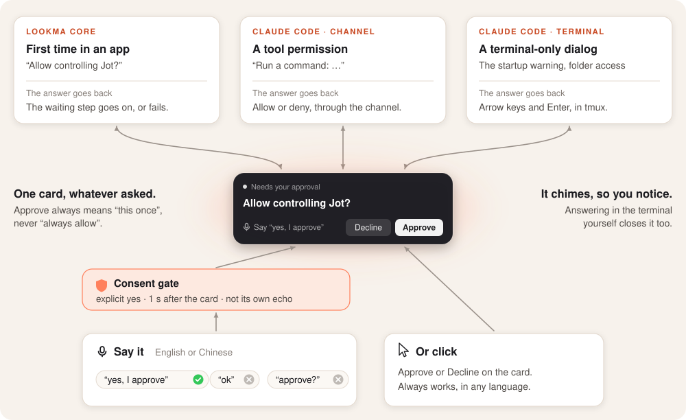

# How Lookma works

Lookma keeps one small model of what is going on:

- **the turn**: one request from you and everything it leads to;
- **the focus**: the target the agent is acting on right now, an app plus a rect and a point;
- **your attention**: whether you are using the keyboard or mouse.

Every step is visible by default. The overlay draws only what follows from those three.

This page explains the design. The exact messages are in [protocol.md](protocol.md), the contract between the pieces.

## The pieces

<picture>
  <source media="(prefers-color-scheme: dark)" srcset="images/architecture-dark.svg">
  
</picture>

| Piece | Where | What it does |
|---|---|---|
| Core | `core/` | A resident Node process on 127.0.0.1:8790. The only piece that decides anything: it holds the turn, focus, attention and approval cards, runs the hands pipeline and mints voice keys. |
| App | `app/` | `Lookma.app`, a small Swift menu bar app with no Dock icon. It provides primitives and decides nothing: Accessibility (AX) reads and presses, screenshots, keyboard and mouse input, seconds since your last input, and the overlay window. macOS permissions belong to it, so the core launches it with `open`. |
| Overlay | `overlay/` | A web page in the app's full-screen, transparent, click-through window. It draws the capsule, marks and cards, and runs the voice. The window takes clicks only on the card, the Go ahead button and the text box. |
| Executor adapter | `core/executors/<name>/` | Wraps one agent behind the executor contract: `claude`, Claude Code running interactively in tmux, or `codex`, Codex CLI through its app-server. |
| Prompts | `prompts/` | `butler.md` and `butler-tools.json` for the voice, `executor.md` for the agent. |
| Launcher | `bin/lookma`, `core/cli.mjs` | `bin/lookma` only finds Node and runs `core/cli.mjs`, which checks dependencies, builds the app when its sources changed (`core/app-build.mjs`), and starts the core. `lookma doctor` checks dependencies and permissions. |

## A turn, end to end

Say “find three ramen places near the ferry and put them in a new note”:

1. **You talk.** You just say it. The overlay streams your microphone to OpenAI Realtime, and the server hears when you stop. The voice starts the work with its `do` tool, keeping your names, numbers and dates; to you it is one assistant doing the work. The capsule shows what it heard and the exact text sent, so a mishearing shows at once.
2. **The core starts a turn** and hands the text to the executor. If a turn is already running, the text goes in as a correction instead (`prompt` with `steer: true`).
3. **The agent works.** Anything on screen goes through the six hands tools. Anything else (files, shell commands, web searches) uses the agent's own tools; the adapter reports each step, which shows up as the capsule's status line.
4. **Every hands call runs the pipeline** below, one call at a time.
5. **The agent talks back** with `say`: one short sentence in your language. You hear one assistant: the voice speaks it as soon as nobody is talking, on the same session. Questions, confirmations and approval cards go to the front of the queue. Without voice, these are captions only.
6. **The turn ends** when the agent stops. The capsule shows the result and how long it took, then shrinks away.

## The hands pipeline

<picture>
  <source media="(prefers-color-scheme: dark)" srcset="images/hands-pipeline-dark.svg">
  
</picture>

The agent's GUI tools are `see`, `click`, `type`, `key`, `scroll` and `open`. Each call carries a `label`, a few words in your language (“Search for ramen”), which the overlay shows at the target. Every call goes through the same steps, in `core/hands.mjs`:

1. **Resolve** the target to an app, a rect and a point:
   - an element id from the last `see`. Ids stay valid until the next `see`; a stale id is an error.
   - a point in the last screenshot's pixels. The app maps it back to screen points.
   - a Dock icon: opening an app means pressing its Dock icon, as a person would.
   - the app itself, for `see`, `type`, `key`, and `scroll` with no element or point.
2. **Grant.** The first time the hands touch an app, the core raises its own card (“Allow controlling Maps?”). The answer is kept in `~/.lookma/apps.json`. A no ends the step with an error that the agent reads.
3. **Attention.** The app reports the seconds since your last key or mouse event every half second. You count as busy when you used either in the last 3 s.
   - **Not busy:** the target comes to the front.
   - **Busy:** nothing takes the front, the marks step aside, and a yellow tab at the screen edge says where it is working. What happens depends on the step:

   | Step | While you are busy |
   |---|---|
   | `see`, and `click` on an element that supports an AX press | Runs in the background. |
   | `type`, `key`, `scroll`, `open`, and `click` at a point or on an element without an AX press | Waits until you pause for 3 s, or until you say “go ahead”. The tab says it is waiting. |

4. **Mark.** The core sets the focus. The overlay moves the coral ring to the target, hangs the label off it and flies the ghost cursor to the point. The core waits about 350 ms so the marks arrive before anything happens.
5. **Act** through the app. Input that needs the front is posted only when it will land in the target: the point must be on the target's window, and the target must have keyboard focus. Otherwise the step fails with a reason.
6. **Return** to the agent. `see` returns the screenshot plus a text list of elements (id, role, text). Every other tool returns one line: what happened and which app is frontmost now.

Screenshots contain only the target app's windows, its menus and popups included. The overlay and anything covering the app are left out. The long edge is at most 1280 px.

Saying “stop” aborts the step in flight and everything queued, and interrupts the agent: Escape for Claude Code, `turn/interrupt` for Codex.

## Approvals

<picture>
  <source media="(prefers-color-scheme: dark)" srcset="images/approvals-dark.svg">
  
</picture>

Everything that needs your OK is the same thing: one card, answered by voice or by click. Cards come from the core and from the agent:

| Source | Example | How the answer gets back |
|---|---|---|
| Core | “Allow controlling Maps?” | The waiting pipeline step continues, or fails. |
| Relay (Claude Code) | A Claude Code tool permission request, forwarded by the channel | Through the channel. |
| Terminal (Claude Code) | Dialogs only the terminal shows: the development-channel warning at startup, a path outside the working folders | Keys sent to the tmux pane. |
| app-server (Codex) | A command or file change that needs more than the sandbox allows | The reply to Codex's request. |

The rest of this section is about Claude Code. Codex asks through its app-server, one request per question, so there is nothing to merge: Approve answers `accept` (this once, never `acceptForSession`) and Decline answers `decline`, and Codex goes on without that step.

**Reading the terminal.** While the session lives, the adapter reads the tmux pane every second. One generic parser finds a dialog, a question plus numbered options, with no per-dialog code. Only permission and trust questions become cards: a question with Yes and No options, or a known startup warning. Settings pickers such as `/model` never do.

**One card per dialog.** A relayed request is also drawn in the terminal, so the two routes would see the same dialog twice. A dialog is known by its signature, its question plus its options. It counts only after it has been on screen for two polls in a row, so a relay that arrives just after it is drawn still claims it. A card closes when the pane shows no dialog or a different one, so answering in the terminal yourself works too.

**What Approve picks.** Approve always means “yes, this once”. On the relay it sends allow. In the terminal it picks the option that is exactly “Yes”, else the first that starts with “Yes”, else the first option. It always skips options that grant more than this one request: anything containing “allow”, “always”, “all future”, “don't ask again”, “accept edits” or “switch to auto mode”. Decline picks a “No” option, or presses Escape. The card shows the question and its detail, never Claude Code's numbered options, so it cannot suggest that Approve might pick “always”.

**Keys.** Only arrow keys move the cursor, never digits. Enter is pressed only when a fresh read of the pane shows the cursor on the right option of the same dialog. If that check fails, nothing was answered, and the dialog still on screen gets a new card.

## When it listens

While Lookma runs, voice is on and it is not paused, it listens. You just talk, from the desk or from across the room. With a headset you can talk over the voice to interrupt it. macOS shows its microphone indicator the whole time. Pause from the menu bar, with ⌃⌥P or by saying “pause”, and the microphone is off until you resume.

**One warm session.** The overlay (`overlay/voice.js`) keeps one OpenAI Realtime session connected over WebRTC, with the microphone attached. The voice speaks on the same session, so it can tell you something at any time, and it remembers the conversation from one turn to the next. Pausing closes the session; resuming opens a fresh one. With voice off (`LOOKMA_NO_VOICE=1` or no OpenAI key) there is no session and no microphone.

**Turns.** The server finds them: semantic voice activity detection, at medium eagerness, so a short pause to think does not cut you off. `LOOKMA_AUDIO` says how you hear the voice. In a `room` (the default) noise reduction is `far_field` and the voice finishes its sentence when you talk over it, since what it hears then may be its own echo. With a `headset` it is `near_field` and your speech stops the voice at once. Either way a turn does not answer itself: the server creates no reply on its own.

**No replies to silence or noise.** A microphone that is always on hears the whole room. So the page asks for a reply only when the turn's transcript means something:

| The transcript | What happens |
|---|---|
| Empty, a filler (“um”, “hmm”) or a short noise fragment (“Tja”) | Dropped. Nothing is said. |
| A real short command: “stop”, “pause”, “no”, “yes, I approve” | Kept, however short. |
| Anything longer | Kept: the voice answers, or calls `do`. |
| Does not arrive within about 2.5 s | The voice answers anyway. |

The decision is one small pure function, with its own tests. Speech that gets through but is not meant for Lookma, such as people talking to each other or a TV, is the voice's call: its instructions (`prompts/butler.md`) tell it to stay silent.

**A terse butler.** The voice answers in one short sentence, in your language and in the first person. It never restates what you asked, adds no filler or acknowledgements, and calls its tools silently, since the screen already shows the work. A reply is capped at `LOOKMA_VOICE_MAX_TOKENS` (about 200).

**Language.** Set `LOOKMA_VOICE_LANGUAGE` (an ISO code such as `en` or `zh`) and the transcriber is told the language you speak. There is no transcription prompt: it makes the transcriber drop question marks, and the approval check relies on them.

**Health.** If the session closes or fails, the overlay reconnects in the background. Before the Realtime session time limit, it opens a fresh one while nothing is going on, never in the middle of a turn, with its key minted ahead of time. A session that replaces an old one starts knowing what you were just told: the pending cards and the updates and reports of the last 5 minutes, marked as from earlier, with no reply. So “yes, I approve” still answers a card announced on the old session.

## Voice consent

<picture>
  <source media="(prefers-color-scheme: dark)" srcset="images/consent-chart-dark.svg">
  
</picture>

The voice model hears your audio, and a separate transcriber writes it down. On its own the model approves far too easily (above). A voiced approval needs the model, the transcript and timing to agree (`overlay/consent.js`):

1. **The voice calls `answer(allow=true)`.** Its instructions allow that only after an explicit yes. When it asks, it ends with “Approve?” and never says the approval phrase itself: the card shows the phrase.
2. **You saw the card.** Your answer started (the server heard your speech start) at least 1 s after the card appeared. A “go ahead” meant for something else as the card popped up does not count.
3. **It is not its own echo.** An answer started while the voice was playing counts, because people answer as soon as they see the card. It is refused only when what the voice was saying itself contained an approval phrase.
4. **The transcript is an explicit approval.** The transcript of that same turn, matched by the item id the server gave it, must:
   - use only words from a short list. Any other word, in any language, fails closed: “wait”, “not yet”, “hold on”, a garbled transcript.
   - contain no question mark.
   - pair an approval word with a yes (“yes, I approve”, “OK, do it”), use two approval phrases (“approved, do it”), or be in the first person (“I approve”).

   A lone “approve” or “go ahead” is also how people ask back, so it never counts. Neither does a lone “ok” or “sure”. If the transcript does not arrive within 3 s, nothing is approved.

Declines go through the same checks, with an explicit no instead (“no”, “cancel”, “don’t”). A wrong no is not free either: the agent loses that step, and on Claude Code's startup card it shuts Claude Code down.

When a voiced answer is refused, nothing is sent. The card shows “Not a clear yes” with what was heard, and the voice asks again. The approval words are English, whatever language you speak to it in; you can always click instead. Clicking Approve or Decline always works.

**Commands.** An utterance that is only “stop” (or “cancel”) cancels a running turn at once, without waiting for the voice model. “Go ahead” (or “continue”) resumes a step that is waiting for you. “Pause” pauses: the running turn stops as with “stop”, the voice session closes and the microphone is off until you resume from the menu bar or with ⌃⌥P. Resuming only turns listening back on; the stopped turn stays stopped. This works typed or spoken. While a card is up, your words answer the card instead.

## Background work

Long work with nothing to show on screen goes to Claude Code's background subagents, such as research or a big batch of file edits. They are told not to use `say` or the hands, and they cannot start subagents of their own. Each one ends its final message with a `SAY:` line to speak and a `SHOW:` line to display. The overlay shows running tasks as yellow pills, and the voice reads the report when one finishes. The main session does all screen work itself, because there is one screen and one pair of hands. Codex has no background tasks yet: its subagents are turned off, and everything runs in the turn.

## The executor contract

The core talks to the agent only through an adapter in `core/executors/<name>/index.mjs`:

```js
export function create(ctx)  // ctx: { emit(event), hands(tool, args) → Promise<result>, config, log }
  → { start({ dirs }) → Promise<{ name }>,
      prompt(text, { steer }), cancel(), answer(cardId, allow), stop(),
      connect?(ws), hook?(body) }
```

`steer` is true when a turn is already running. `connect` gets the sockets on `/ws/executor` and `hook` the bodies POSTed to `/hook`; an adapter that needs neither leaves them out. The adapter emits `status`, `turnStart` and `turnEnd`, `step` (a non-GUI step), `say`, `task` (background work), and `approval` and `approvalGone`. GUI steps are not in the contract: the agent calls the hands tools, and the adapter forwards each call to `ctx.hands`. Field-level details are in [protocol.md](protocol.md#executor-contract).

How the Claude Code adapter fills it in:

| Contract | Claude Code |
|---|---|
| `start` | Writes a session folder (`~/.lookma/sessions/lookma/`: `.mcp.json`, `settings.json`, `executor.md` from `prompts/`) and starts interactive `claude` in the tmux session `lookma`, with `--dangerously-load-development-channels server:lookma`. |
| `prompt` | A channel message from `channel.mjs`, a stdio MCP server that Claude Code spawns. It is a thin pipe to the core that also exposes `say` and the hands tools. A correction (`steer`) is sent the same way: Claude Code takes a message that arrives during a turn into that turn. |
| `connect` | The socket `channel.mjs` opens on `/ws/executor`. |
| `cancel` | Escape, sent to the tmux pane. |
| `answer` | The relay, or keys in the terminal (see Approvals). |
| `hook` → `step`, `task`, `turnStart`, `turnEnd` | Claude Code's http hooks, posted to the core's `/hook`. |
| `say` | The `say` tool. |

The session settings allow the hands tools, and deny Claude Code's built-in computer use (the hands are ours) and `AskUserQuestion` (you could not answer it from a card; Claude asks with `say` instead). The folders you pass to `lookma` go into `permissions.additionalDirectories`, so starting asks no trust question per folder.

How the Codex adapter fills it in:

| Contract | Codex |
|---|---|
| `start` | Writes a session folder (`~/.lookma/sessions/codex/`: `home/`, holding only a link to your `auth.json`, and an empty `work/`), starts `codex app-server` with that home, and starts one thread for the whole run, with `executor.md` as its developer instructions. |
| `prompt` | `turn/start`, or `turn/steer` while a Codex turn runs, so a correction lands in that turn. |
| `connect` | The socket of `mcp.mjs`, the MCP server in the thread's config that gives Codex `say` and the hands tools. |
| `cancel` | `turn/interrupt`. The next prompt waits until Codex reports the turn ended. |
| `answer` | The reply to Codex's approval request: `accept` or `decline`. |
| `step`, `turnStart`, `turnEnd` | `item/started`, `turn/started` and `turn/completed` notifications. |
| `say` | The `say` tool. |

Besides its own shell, file edits and web search, Codex gets only Lookma's tools: its own home keeps your Codex MCP servers, plugins and settings out, and Lookma turns off its connectors, plugins, computer and browser use, subagents, memories and image generation. Its commands run in the workspace-write sandbox, which may write only in the folders you pass to `lookma` (plus its `work/` folder and tmp), with no network; anything beyond that is a card.

**Adding an executor.** Write `core/executors/<name>/index.mjs`. Give your agent `say` and the hands tools: if it takes MCP servers, have it spawn a script that calls `serve()` from `core/executors/mcp-bridge.mjs` (as `codex/mcp.mjs` does). That server connects to `/ws/executor`; in your `connect`, hand its messages to `serveTools` from `core/executors/tool-link.mjs`, which forwards each call to `ctx.hands`. Put what your agent needs into `checks.mjs` next to it, so `lookma doctor` and the start check it. Then start with `LOOKMA_EXECUTOR=<name>`.

## Local only

- The core listens on 127.0.0.1 only.
- POST bodies must be `application/json`, so another web page cannot send commands with a plain form.
- WebSocket upgrades are accepted only without an `Origin` header (native clients) or from the core's own origin. Without this check, any web page you visit could drive your computer.
- Your OpenAI key stays in the core. The overlay gets a short-lived key with the voice's instructions and tools baked in.

There are no tokens or accounts beyond that.

## Where things live

| Path | What |
|---|---|
| `~/.lookma/apps.json` | Per-app grants, e.g. `{ "Maps": true, "Notes": false }`. Read on every step, so a hand edit takes effect at once. |
| `~/.lookma/sessions/lookma/` | The generated Claude Code session folder, rewritten on every start. |
| `~/.lookma/sessions/codex/` | The Codex session folder: `home/` (Codex's home, with a link to your login) and `work/` (its working folder). |
| `app/build/Lookma.app` | The app, built from `app/Sources/` by `app/build.sh`. |
| `.env` | Your settings and `OPENAI_API_KEY`. Real environment variables win. |
