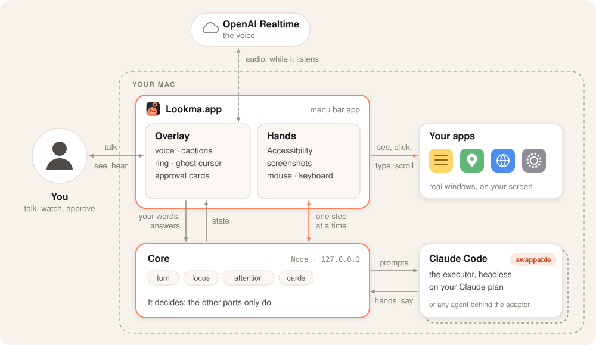

# Protocol (v1)

How the pieces talk. The core holds one model: the turn, the focus (the current hands step) and the user's attention, and every step is visible by default. All user-facing text in the product is English. Anything spoken or narrated follows the language the user speaks.

## Processes

<picture>
  <source media="(prefers-color-scheme: dark)" srcset="images/architecture-dark.svg">
  
</picture>

Three WebSockets meet at the core: the overlay page on `/ws/overlay`, the app on `/ws/app`, and the agent's tools bridge on `/ws/executor`.

- **core** (`core/`) is the only place that decides anything. It serves the overlay page at `/`, WebSockets at `/ws/overlay`, `/ws/app` and `/ws/executor`, and HTTP at `/api/state`, `/api/tell` and `/api/voice/grant`. Beside the overlay it serves the selected voice provider's page half, `/voices/<name>/page.js` (and `/voices/<name>/page/*`), and nothing else of that folder.
- **app** (`app/`) is launched with `open` so macOS permissions belong to it. It connects back to the core, provides primitives, and the menu bar item (pause, resume, type, quit), and makes no decisions.
- **overlay** (`overlay/`) is a page loaded by the app's full-screen, click-through WKWebView. It renders core state and runs the realtime voice session. It also opens in a normal browser for development.
- **executor adapter** (`executors/<name>/`) wraps one agent behind the contract below, and the core's executor host (`core/executor/host.mjs`) is the only code that runs it. `claude` and `codex` ship.

Port: `LOOKMA_PORT`, default 8790. During development use another port (the dev scripts default to 8791), because your everyday Lookma may still hold 8790.

Local-only:
- listen on 127.0.0.1 only;
- POST bodies must be `application/json`;
- WebSocket upgrades are accepted only when `Origin` is absent (native clients) or is the core's own origin. Without this check, any web page could drive the computer.

Nothing else.

## Coordinates

Everything uses **screen points on the main display, origin at top-left**: AX frames, rects in state and the overlay's CSS pixels. The overlay covers the main display 1:1, so a rect from the core is a CSS rect.

Screenshots returned to the executor are downscaled. A point the executor gives in screenshot pixels is mapped back by the app using the `shot` it returned. The executor never sees screen points.

## Core → overlay

On connect, and on every change (coalesced to one per frame), the core sends a full snapshot:

```js
{ type: 'state',
  executor: { name: 'claude', status: 'starting' | 'ready' | 'busy' | 'down', detail },
  turn: null | { id, sent, status, phase: 'working' | 'done' | 'failed' | 'cancelled', said, startedAt, endedAt },
  focus: null | { id, label, action, app, rect, point, phase: 'moving' | 'waiting' | 'acting' | 'done' | 'failed', background, at },
  attention: { busy, idle },
  app: null | { version, permissions },          // the app's hello; null while it is not connected
  cards: [ { id, title, detail, source: 'executor' | 'core', turnId, createdAt } ],
  tasks: [ { id, title, status: 'running' | 'done' | 'failed', action, startedAt, endedAt } ],
  outbox: [ { id, kind: 'info' | 'question' | 'confirm' | 'report' | 'card', speech, display,
              title?, taskId?, cardId?, turnId, held, at, delivered: null | 'spoken' | 'cut' | 'shown' } ],
  paused: false | true }
```

- `turn.sent` is the exact text handed to the executor (the capsule's second row).
- `turn.status` is the latest one-line step description (the third row). Steps that have no screen target, such as reading a file or running a command, only update this line.
- `focus` is the current or last hands step:
  - `rect` is the target's frame and `point` is where the ghost cursor goes;
  - `background: true` means it is acting without bringing the target forward, because the user is busy;
  - `phase: 'waiting'` means it needs the front and is waiting for the user to stop. The overlay shows the edge hint.
- `cards` are pending approvals, oldest first. `source: 'core'` means the core asks for itself, e.g. the first time the hands touch an app. `turnId` is the turn that was working when the card was raised (null outside a turn, e.g. a startup card). A stop withdraws every open card.
- `tasks` are background work with no screen presence. It is shown yellow.
- `turn.said` counts the lines the work said during the turn (see the outbox below).
- `outbox` is what the user is owed by voice, oldest first. See The outbox below.
- `paused` is true while the user has paused. See Pause and quit below.

**The outbox** (`core/outbox.mjs`). Everything the work wants the user told is an entry, kept in the core so it outlives a pause, a voice failure and a page reload:

- `info`, `question`, `confirm`: the executor's `say` (`kind` defaults to `info`, `display` to `speech`). Said while a turn is working, the entry carries that `turnId` and the turn's `said` goes up by one.
- `report`: a background task finished with a result (`taskId`, the task's `title`).
- `card`: the announcement of the card on screen, `cardId`, with the card's title and detail as its text. Only the head of `cards` has one; it is posted when that card becomes the head and removed when the card goes, delivered or not, and only then (`held: true`).
- A turn always ends with something to tell: one that ends `done` or `failed` with `said` 0 gets one entry from the core, "Done." or "That did not work." (the voice says it in the user's language). A stopped turn (`cancelled`) drops its undelivered entries, along with its cards.

Each entry gets exactly one receipt (`delivered`, first one wins): `spoken` (the user heard it), `cut` (the user talked over it), or `shown` (left on screen). An entry with no receipt is still owed. Delivered entries are kept for 5 minutes (the context a new voice session is given; the core trims the list whenever a voice grant is minted, so that holds however quiet it has been), and the list keeps at most the newest 50. A held entry (a card's) is kept, receipt or not, until its card goes.

The overlay reads the outbox from every snapshot. Its captions come from it (the newest entry that is not a card or report is the said line; report entries caption their task), and the voice announces what is owed when nobody is talking and sends the receipts. With no voice, everything owed gets `shown`. The overlay plays a soft chime when a new card appears.

The answer to an overlay request (see Overlay → core) goes to the requesting socket only:

```js
{ type: 'ack', id, ok: true, ... } | { type: 'ack', id, ok: false, error }
```

**Voice session** (`overlay/voice.js`, `overlay/voice/`). Always listening, full duplex: while voice is on and not paused, one warm session is connected with the microphone attached.

- **Warm session.** One Realtime WebRTC session, its audio transceiver `sendrecv` with the microphone track. macOS shows its mic indicator. The voice speaks on the same session, and it keeps the conversation across turns.
- **Turns** come from the server: `turn_detection` is `semantic_vad` with `eagerness: 'medium'` and `create_response: false`. The audio setup (`LOOKMA_AUDIO`) sets the rest: `room` (the default) has `interrupt_response: false` and `far_field` noise reduction, so speech over the voice does not cut it off; `headset` has `interrupt_response: true` and `near_field`, so it does (barge-in).
- **The floor** (`overlay/voice/floor.js`) decides who speaks: one reply at a time, and only once the user's turn is committed. What the voice owes is user turns (a reply) and outbox entries (an announcement). Every committed turn gets a `response.create` at once; the voice itself decides whether it was meant for it, and a reply that is a `pass` call, or has nothing in it, deletes that turn from the conversation. A turn is shown as heard when the reply's first output that is not a `pass` arrives.
- **Replies.** `response.create` carries the grant's `session.responses[kind]` and never instructions: a reply to new turns (`turn`) may call tools; every other reply (`speak`: an announcement, or a tool result to say) is speak-only (`tool_choice: 'none'`). A tool result the user has not heard (an error, `status`, or any result after a reply that said nothing) gets a speak-only reply.
- **Announcements.** What the outbox owes is announced once nobody has talked for 0.7 s, after any user turn, all of it in one reply, in outbox order, as user items marked as updates. When its audio has played, the entries get `spoken`. Talked over by a user who then gets an answer (the reply to their turn is not a `pass`), they get `cut`. A reply that fails (cancelled by noise, rejected, cut off by a dropped session, or with no news for 30 s) is tried again; a reply the user's voice cancelled counts as failed only once the reply to their turn turns out not to be an answer, so a request spoken in pieces is never lost. After two failures an entry gets `shown`, and a request the voice never acted on shows "say that again". A receipt is sent again while a snapshot still shows the entry owed, so one lost with the core link heals itself.
- **Turn records.** Each turn is recorded when its speech starts: its item id, `startedAt` (when the event arrived) and `overButler` (whether the voice's audio was playing then). Its transcript is matched by item id when it arrives.
- **Health.** The session reconnects in the background when it closes or fails, with backoff. While idle (nothing heard, said or owed for 10 s), it is renewed after the grant's `renewAfter` (before the Realtime session limit), with its grant minted ahead.
- **Context.** Every new session is first given the outbox entries that already have a receipt (the last 5 minutes, and the card on screen), as user items marked "from earlier" and with no `response.create`. So "yes, I approve" still answers a card announced on the old session, also after a page reload.
- **Paused:** no session at all, and no microphone; what is owed stays in the outbox and is announced after resume. **Voice off** (`LOOKMA_VOICE=off`, no OpenAI key): no session, captions only, and everything owed gets `shown`. A page opened with `?voice=0` is a spectator: no session, captions only, and no receipts, so it never settles what the app's voice still owes.

**Voice approval** (`overlay/consent.js`): a spoken answer (approve or decline) counts only when all of these hold:
- it was spoken at least 1 s after the card rendered (the turn's `startedAt`);
- it cannot be the assistant's own voice: said over the voice (`overButler`), it counts unless the voice itself was saying an approval phrase;
- its own transcript, matched by the turn's item id and awaited up to 3 s, is explicit: "yes, I approve", "approved, do it", or a clear "no", "don't". A lone "approve" or "go ahead" is not enough, and any hesitation fails. "Cancel" is a stop, never a decline.
- the core accepts it: the butler's `answer` sends an `answer` request, and the card shows Approved (or Declined) only after the ack says `ok`.

Otherwise the voice asks again. The card's hint reads: Say “yes, I approve”. Clicking Approve always works.

## Overlay → core

Requests carry an `id` (`r1`, `r2`, … per page) and get exactly one `ack`, to the requester only. The core alone decides whether a request applies; the page never does.

| Request | Ack |
|---|---|
| `{ type: 'tell', id, text, source: 'voice' \| 'typed' }`: a new instruction; the core prompts, or steers if a turn is running | `{ ok: true, state: 'started' \| 'added' }`, or `{ ok: false, error }` (empty text, paused, the executor not running) |
| `{ type: 'answer', id, cardId, allow, via: 'voice' \| 'click' }` | `{ ok: true }`, or `{ ok: false, error: 'gone' }` |
| `{ type: 'control', id, action: 'stop' \| 'go_ahead' \| 'pause' }` | `{ ok: true }`, or `{ ok: false, error: 'nothing_running' \| 'not_waiting' \| 'unknown_action' }` |

- `stop` stops the working turn: the executor host interrupts the agent behind its stop gate (see Executor contract), the waiting hands step fails, queued steps drop and every open card is withdrawn. `go_ahead` lets a step waiting with `focus.phase: 'waiting'` act now. `pause` is idempotent (see Pause and quit).
- The page's `request` resolves `{ ok: false, error: 'not connected' }` when the socket is closed or closes before the ack, and `{ ok: false, error: 'no answer' }` after 3 s. It never resends.

Without an ack:

```js
{ type: 'delivered', ids, how: 'spoken' | 'cut' | 'shown' }   // receipts for outbox entries; idempotent, seen in the next snapshot
{ type: 'log', text }                                // a line for the core's log (the voice's decisions)
```

Spoken "stop", "go ahead" and "pause" are the voice's: it calls its `control` tool. Every tool that reaches the core (`do` sends `tell`, `answer`, `control`) gets the ack as its output, verbatim, so the voice says what really happened. A typed line of just "stop", "go ahead" or "pause" is sent as that `control` request whatever the state (`commandFor` in `overlay/consent.js`); a failed typed request shows its error on screen.

`POST /api/voice/grant` → `{ provider, credential?, startBy?, renewAfter, label, session? }`, one grant per voice session, minted by the selected provider's `mint.mjs` through the voice host (`core/voice/host.mjs`). `provider` names the page half the session imports (`/voices/<provider>/page.js`); `credential` is what it connects with, never the real key, which stays in the core; `startBy` (epoch ms) is the last moment a connection may start with it; `renewAfter` (ms) is when the session is swapped at the next idle moment; `label` is for the log; `session` is the provider's own data. A 503 means no voice, for good (`LOOKMA_VOICE=off`, or a required setting such as `OPENAI_API_KEY` unset). Any other error (a 502 when the provider's service refused) means try again later.

For `openai`, `credential` is an ephemeral OpenAI Realtime key, with the session config (the voice's instructions from `prompts/butler.md`, its tools `do`, `status`, `answer`, `control` and `pass` from `prompts/butler-tools.json`, transcription (with `language` from `LOOKMA_VOICE_LANGUAGE` when set, and no prompt), server turn detection as above, `max_output_tokens` from `LOOKMA_OPENAI_MAX_TOKENS` (default 200), and voice) baked in by the core; `startBy` is the key's expiry, `renewAfter` 50 minutes, and `session.responses` the parameters of each kind of reply (`voices/openai/mint.mjs`), so the page never builds one.

**Voice provider contract** (provisional until a second provider exists). A provider is `voices/<name>/`: `manifest.mjs` (as an executor's, below), `mint.mjs` in the core and `page.js` in the overlay; `overlay/voice/contract.js` has the exact shapes.

```js
// voices/<name>/mint.mjs
export async function mint({ options, instructions, tools, audio, language, log }) → { credential?, startBy?, renewAfter, label, session? }
// voices/<name>/page.js, a browser module
export function connect(grant, { signal, openMic, onEvent, onClose, log }) → Promise<{ send(effect) }>
```

- `tools` are `prompts/butler-tools.json`, `[{ name, description, parameters }]`; `audio` is `room` or `headset`; `language` is `LOOKMA_VOICE_LANGUAGE` or `''`. A `mint` that throws is the 502.
- `connect` resolves once the connection is live and rejects in words. `signal` aborts when the session ends it, live or not: release everything. `openMic()` is the session's microphone, kept across reconnects. `onClose(why)`: the connection ended by itself.
- The provider owns turn detection and emits the voice events: `turn.started`, `turn.stopped`, `turn.committed { id }` (one id per user turn; `started` as soon as the user is audibly speaking), `turn.transcript { id, text | null }` (once per committed turn), `response.started { response }` (once per reply it began for a `create`, before its other events), `response.item { response, kind }` (as soon as the reply's first output is known), `butler.said { response, text, final }`, `response.done { response, status, items }` (`completed`, `cancelled`, `failed` or `incomplete`; items through `item()`, which makes a `pass` call an item of kind `pass`), `audio.started`, `audio.stopped`, `audio.cleared { response }` (the truth about playback at the speaker), and `error { eventId, message }`.
- It carries out the four effects and nothing else: `create { kind: 'turn' | 'speak', eventId }` starts one reply now (a `speak` reply only speaks; the service never replies by itself), `tell { texts }` adds texts the butler was told, with no reply, `drop { items }` voids items (a pending call among them is resolved silently), and `output { results: [{ callId, output }] }` gives call results, with no reply.

**Overlay ↔ app (local, not the core).** The page posts `{ hitRects: [rect…], typing, voice, listening, speaking }` to `window.webkit.messageHandlers.lookma` whenever one of them changes:

- `hitRects`: the app makes the window accept mouse events only while the pointer is inside one of those rects (the card), and click-through everywhere else.
- `typing`: the app gives the window the keyboard only while the typed input is open, and hands it back when the page closes it.
- `voice`: voice works (voice on, not paused, the session not failing).
- `listening`: the user is speaking (the server heard speech start, and not yet stop). The app shows it in the menu bar.
- `speaking`: the voice is answering (thinking or talking).

The app calls the page with `evaluateJavaScript`; it returns nothing:

```js
window.lookma.toggleTyping(true)                      // "Type a Request…"
```

## App ⇄ core (`/ws/app`)

App → core:

```js
{ type: 'hello', version, permissions: { accessibility, screen, microphone }, screen: { w, h, scale } }
{ type: 'attention', idle }                    // seconds since the last user key or mouse event; every 0.5 s
{ type: 'pause' } | { type: 'resume' }         // the menu bar item, or the hotkey ⌃⌥P
{ type: 'quit' }                               // Quit in the menu bar
```

Core → app, besides requests:

```js
{ type: 'paused', paused }                     // on connect, and on every change
{ type: 'quit' }                               // the core is stopping; the app quits with it
```

## Pause and quit

The core is the only place where `paused` changes; the overlay and the app only ask.

- **Pause** (`control` `pause` from the overlay, or `pause` from the app). If a turn is working, the core stops it exactly as `stop` does. Then `paused` becomes true. While paused:
  - the overlay closes the voice session entirely (WebRTC closed, mic track stopped), so nothing is heard, sent or billed, and the voice stops talking; what is owed stays in the outbox;
  - the capsule shows "Paused" and how to resume: the menu bar or ⌃⌥P;
  - marks clear, and the hands refuse every step;
  - `tell` is refused with the same hint (its ack's `error`; `POST /api/tell` answers 409).
- **Resume** (`resume` from the app). `paused` becomes false. The overlay reconnects the warm voice session, with the microphone. Nothing else starts: a turn the pause stopped stays stopped until the user asks again.
- **Quit** (`quit` from the app). The core runs its usual shutdown, the same as Ctrl-C: `{ type: 'quit' }` to the app, the executor's `close`, the server closes and the process exits, so the `lookma` command ends. If the core is not reachable, or does not answer within 5 s, the app quits by itself.

The app's menu bar item, the seal, shows the state the core and the page last sent: its ring filled while the user speaks, a pause sign while paused, and dimmed while not connected. Its menu has Pause or Resume (⌃⌥P), Type a Request…, and Quit.

- ⌃⌥P is a Carbon hot key, which needs no extra permission; when another app holds it, the app logs that and the menu still works.

Core → app requests, and the app's replies:

```js
{ type: 'req', id, op, args }  →  { type: 'res', id, ok: true, result } | { type: 'res', id, ok: false, error }
```

| op | args | result |
|---|---|---|
| `see` | `{ app? }` (default: frontmost) | `{ image (png base64), shot: { w, h, rect }, app, window: { title, rect }, elements: [{ id, role, text, rect }] }` |
| `resolve` | `{ element } \| { point:[x,y] } \| { dock: appName } \| { app }` | `{ app, rect, point, frontmost, pressable }` |
| `front` | `{ app }` | `{}` (best effort: the ops that post input check the front themselves) |
| `press` | `{ element }` | AX press: `{}` |
| `click` | `{ point }` (screen points) | `{}` |
| `type` | `{ text }` | `{}` |
| `key` | `{ combo }` e.g. `"cmd+t"` | `{}` |
| `scroll` | `{ point, direction, amount }` | `{}` |
| `open` | `{ url } \| { path }` | `{ app }` |

Element ids come from the last `see` and stay valid until the next one. A stale id is an error: "call see again".

## The hands pipeline (core, one function, one step at a time)

The executor's GUI tools are `see`, `click`, `type`, `key`, `scroll` and `open`. Each takes a `label`, a short description of the step in the user's language. Every call runs the same steps:

1. **Resolve** the target to `{ app, rect, point }`: an element, a screenshot point, a Dock item (`open` an app = press its Dock icon), or the app itself (`see`, `type`, `key`).
2. **Grant.** If the hands have never touched this app, raise a `core` card ("Allow controlling Maps?") and wait. A no ends the step with an error the executor can read. Answers persist in `~/.lookma/apps.json`.
3. **Attention.** Visible by default: if the user is not busy (idle ≥ 3 s), bring the target forward. If they are busy:
   - steps that can act in the background (AX `press`, `see`) proceed with `background: true` and an edge hint;
   - steps that need the front (`type`, `key`, a coordinate `click`, `scroll`, opening an app) wait with `focus.phase = 'waiting'` until the user is idle ≥ 3 s or says go ahead (`control` `go_ahead`).
4. **Mark.** Set `focus` (label, rect, point). Wait about 350 ms so the ring and ghost cursor arrive before anything happens.
5. **Act** through the app, then set `focus.phase` to `done` or `failed`.
6. **Return** to the executor:
   - `see` → the image plus the element list as text;
   - every other tool → one line saying what happened and what is frontmost now.

## Executor contract

An executor adapter is a driver for one agent session. The core owns the user's turn, the cards, the tools and the outbox; the executor host (`core/executor/host.mjs`) loads the adapter, and the adapter only translates: prompts and an interrupt go down, the agent's activity comes up.

```js
// executors/<name>/index.mjs
export function create(ctx) → {
  start({ dirs }) → Promise   // resolves when the agent can take a prompt and call its tools;
                              // rejects in words. Called again after close() (a restart).
  prompt(text) → Promise      // deliver one user message; rejects if it could not
  interrupt() → Promise       // stop the current work; resolves when the agent is idle and nothing
                              // of the stopped work will be emitted or called any more
  close() → Promise           // end the session and every child process
}

ctx = {
  emit(event),
  tools: { server: 'lookma', mcp(extras?) → { command, args, env } },   // the tools bridge to spawn
  ask({ title, detail }, signal?) → Promise<true | false | null>,        // a card; null: withdrawn
  options,        // the adapter's settings, from its manifest, validated
  instructions,   // the text of prompts/executor.md
  sessionDir,     // <data>/sessions/<name>, created, the adapter's to fill
  env,            // the environment for child processes, without other plug-ins' secrets
  log,
}
```

Events:

```js
{ type: 'turnStart' }                       // the agent became busy without a prompt from the core
{ type: 'turnEnd', ok, summary?, error? }   // the agent became idle; error says why it failed
{ type: 'step', title }                     // a step of the main work that is not on screen
{ type: 'task', id, title, status: 'running' | 'done' | 'failed', action, result: { speech, display } }
{ type: 'down', detail }                    // the session died by itself
```

- **Steering.** `prompt` while the agent works adds the text to the running work as soon as the agent can take it; it never restarts the conversation and is never lost.
- **Cards.** `await ctx.ask(card)` is `true` or `false`, the user's answer, or `null` when the card was withdrawn (a stop, a restart, close, or the adapter's own `signal`, for a request the agent closed itself); the adapter then answers its agent "deny". Approve means once: an adapter never maps a yes to an "always allow" option.
- **Steps.** `step.title` comes from `core/executor/steps.mjs`, `title(kind, detail)`; calls to `ctx.tools.server` are never steps (the hands show themselves).
- **The host** owns everything else, once:
  - **status** `starting` until `start()` resolves, then `ready`; `down` when a start fails, after `close`, or when recovery is used up;
  - **the prompt line**: prompts go to the adapter one at a time, in order, only while `ready` and not stopping; a rejected `prompt` fails the turn with its reason;
  - **the stop gate**: from the core's stop until `interrupt()` resolves, the adapter's events are dropped, tool calls are refused, open cards are withdrawn, the hands stop, and prompts told before the stop are discarded;
  - **recovery**: a `down` event, or an `interrupt()` that has not resolved after 10 s, fails the running turn with the reason, closes the session and starts it again (status `starting`, "…; restarting"); a second failure within a minute leaves it `down`;
  - **the turn text**: a failed turn that said nothing tells "That did not work: <error>."; `summary` goes to the log only.
- `lookma start` launches the app without waiting for the executor: prompts told while it starts wait in the host.
- `executors/<name>/manifest.mjs` (a voice has one too, in `voices/<name>/`) exports `default { title, settings, checks? }`, read and validated only by `core/plugins.mjs`. A setting is `{ default, help, env?, secret?, required? }`: its type is the type of `default` (string, boolean written `1` or `0`, number), its name is `LOOKMA_<NAME>_<KEY>` unless `env` names a well-known variable (`OPENAI_API_KEY`), an empty value is unset, and `secret` is never printed and kept out of other plug-ins' `ctx.env`. The adapter gets the checked values as `ctx.options`. `checks` is a list of functions `options => finding`, run by `lookma doctor` and before `lookma start`. A manifest may import only Node's own modules and the helpers `ok`, `warn`, `fail`, `sh` and `atLeast` from `core/doctor.mjs`, so it works before `npm install`.

GUI steps are not in the contract. They arrive as hands tool calls through the tools bridge.

**The tools bridge.** The agent gets `say` and the hands from `core/executor/bridge.mjs`, a stdio MCP server it spawns from `ctx.tools.mcp(extras)`. The spec's environment carries `LOOKMA_CORE_URL` and `LOOKMA_TOOLS` (the server's name, its tools as `core/tools.mjs` defines them, and the `extras`: `toolMeta`, merged into each tool's `_meta`, and the server's `instructions`). The bridge dials `/ws/executor` before it answers MCP, then pipes every call:

- bridge → host: `{ type: 'call', id, tool, args }`;
- host → bridge: `{ type: 'res', id, ok, result | error }`: `{ text, image? }` (a `say` is `{ text: 'said' }`), or the error the agent reads.

The bridge returns `see`'s screenshot as an MCP image, and an error as a tool error.

**Conformance.** `core/dev/check-executors.mjs` runs one list of scenarios over every executor with a `dev/fake-agent.mjs`, a script that speaks the agent's protocol in place of its binary: ready, prompts, tools through the bridge, cards allowed, declined and withdrawn, steering, a stop and its stragglers, a stop that never resolves, the agent dying, and `close`.

### Claude Code adapter (`executors/claude/`)

- **Run.** The Claude Agent SDK (`@anthropic-ai/claude-agent-sdk`, imported by `index.mjs` only) runs the user's installed `claude` (the first on `ctx.env`'s `PATH`, `pathToClaudeCodeExecutable`), headless, as one `query()` per session in streaming-input mode: the prompt stream stays open between turns. It needs Claude Code 2.1.330 or later, the version the SDK was built against.
- **Isolation.**
  - `settingSources: []`: none of the user's, project or local settings, so no CLAUDE.md, hooks or plugins. Lookma's own settings go in as flag settings (`settings`): `permissions.allow` the `lookma` server (say and the hands never ask), `permissions.deny` `mcp__computer-use`, `AskUserQuestion` and `Agent(fork)`, and `env.CLAUDE_CODE_MAX_SUBAGENT_SPAWN_DEPTH=1`.
  - `strictMcpConfig: true`, `mcpServers: { lookma: ctx.tools.mcp({ toolMeta: { 'anthropic/alwaysLoad': true }, instructions }) }`, sent over stdin (`mcpServersDelivery: 'initialize'`) so the bridge's environment is not on the command line.
  - `cwd`: the empty `<data>/sessions/claude/work`; `additionalDirectories`: the user's folders.
  - The environment is `ctx.env` without a parent Claude Code's session markers (`CLAUDECODE`, `CLAUDE_CODE_*`, `CLAUDE_AGENT_SDK_*`), so a Lookma started from inside Claude Code still uses the user's own login.
- **Options.** `model` (`LOOKMA_CLAUDE_MODEL`), `permissionMode` (`LOOKMA_CLAUDE_PERMISSION_MODE`), `systemPrompt`: Claude Code's own preset with `ctx.instructions` appended, plus the background-task convention below. `LOOKMA_CLAUDE_FLAGS` becomes `extraArgs`.
- **Start.** `query()`, then its `initializationResult()`, then `mcpServerStatus()` until `lookma` is `connected` (a failed server rejects the start). The log names the login in use (`account.subscriptionType`, or the API key source). After `close`, `start` passes the last session id as `resume`, so a restart goes on with the same conversation.
- **Turns.**
  - `prompt` → one user message into the stream. During a turn, Claude Code takes it into that turn after the running tool calls.
  - `interrupt` → `Query.interrupt()`, resolving on the stopped turn's `result` (`error_during_execution`). Nothing runs: it resolves at once.
  - `result` → `turnEnd`: `ok` for a `success` that is not `is_error`; `error` from the result's text or its `errors`; `summary` is the result's text.
  - A main-agent `system/init` or `assistant` message while no turn runs → `turnStart` (a finished background task woke the agent).
  - The stream ending by itself (Claude Code exited) → `down`.
- **Hooks**, as SDK callbacks (`hooks.mjs`):
  - `PreToolUse` of the main agent → `step`, titled by `core/executor/steps.mjs`; the `lookma` server's tools are skipped. An `Agent` call is the step `Start: <description>`.
  - `SubagentStart` (with an `agent_type`; Claude Code's internal agents have none) → `task` running, titled by the `Agent` call's description; the subagent's own `PreToolUse` → `task` with an `action`.
  - `SubagentStop` → `task` done, with its report split into `SAY:` (speech) and `SHOW:` (display) lines. A subagent's `SubagentHandback` message is its report when there is one.
  - The convention is the adapter's: it appends its paragraph (start background subagents only for long work with nothing on screen; no `say` or hands; end with `SAY:` and `SHOW:`) to `ctx.instructions`.
- **Approvals.** `canUseTool` → `await ctx.ask(card, signal)` (`approvals.mjs`): the card is a question per tool (`Run this command?` with the command, `Write this file?`, `Open this web page?`, …, else `Allow this step?` with the step's title), plus Claude Code's `blockedPath` and `decisionReason`. `true` → `{ behavior: 'allow', updatedInput }` for this call only (the suggested rules are never passed back); `false` or `null` → `deny`. When Claude Code cancels the request itself (an interrupt), the SDK aborts `signal` and the card goes.

### Codex adapter (`executors/codex/`)

- **Run.** `codex app-server` runs as a child process, speaking newline-delimited JSON-RPC on stdio (`rpc.mjs`), with `--strict-config`, the login kept in a file (`cli_auth_credentials_store="file"`), and the features `apps`, `plugins`, `computer_use`, `browser_use`, `multi_agent`, `memories` and `image_generation` turned off. Its environment is `ctx.env`, so the voice's OpenAI key is not passed on. It is checked against Codex 0.163.0; app-server is experimental.
- **Isolation.** `CODEX_HOME` is `<data>/sessions/codex/home`, which holds only a link to the user's `auth.json`: the login is shared, while the user's own config, MCP servers and plugins stay out. The thread's working dir is the empty `<data>/sessions/codex/work`, so no `AGENTS.md` is read.
- **Start.** `initialize` (with `experimentalApi`, and the streaming deltas and usage notifications opted out), `initialized`, then one `thread/start` per session:
  - `cwd`: the work dir; `model`: `LOOKMA_CODEX_MODEL` or Codex's default; `ephemeral: true`;
  - `approvalPolicy: 'on-request'`, `sandbox: 'workspace-write'`, `config.sandbox_workspace_write: { writable_roots: <the user's dirs>, network_access: false }`;
  - `developerInstructions`: `ctx.instructions`, after Codex's own base prompt;
  - `config.mcp_servers.lookma`: `ctx.tools.mcp()`, with `default_tools_approval_mode: 'approve'` and `tool_timeout_sec: 600`, since a hands call may wait on the user's card.

  `start` resolves once `mcpServer/startupStatus/updated` says `lookma` is `ready` (and rejects if it failed). A restart begins a fresh thread.
- **Turns.**
  - `prompt` → `turn/start { threadId, input: [{ type: 'text', text, text_elements: [] }] }`, or `turn/steer { threadId, input, expectedTurnId }` while a Codex turn runs; a refused steer (the turn has just ended) becomes a `turn/start`;
  - `interrupt` → `turn/interrupt { threadId, turnId }`, resolving on that turn's `turn/completed`;
  - `turn/started` → `turnStart`; `turn/completed` → `turnEnd` with `ok` when its status is `completed`, `error` from the turn's error, and the last agent message as `summary`;
  - `item/started` → `step`: a command (as Codex reads it, e.g. "Read notes.txt", else the command line), a file change, a web search, another MCP server's tool. The hands, reasoning and messages give none;
  - app-server exiting by itself is `down`.
- **Cards.** One per request, through `ctx.ask`:

  | Request | Card | Approve | Decline or withdrawn |
  |---|---|---|---|
  | `item/commandExecution/requestApproval` | "Run this command?" (or network access, or input to a running command), with the command and Codex's reason | `{ decision: 'accept' }` | `{ decision: 'decline' }` |
  | `item/fileChange/requestApproval` | "Change these files?", with the paths of its file change | `{ decision: 'accept' }` | `{ decision: 'decline' }` |
  | `item/permissions/requestApproval` | "Allow more access?", with what is asked for and why | `{ permissions: <as asked>, scope: 'turn' }` | `{ permissions: {}, scope: 'turn' }` |

  Never `acceptForSession` or `scope: 'session'`: Approve is this once. If a request does not offer `accept`, Approve answers `decline`. A card is withdrawn, with no answer, on `serverRequest/resolved`, at the end of its turn, or when app-server exits. Without a card: `mcpServer/elicitation/request` is declined and `currentTime/read` is answered. Any other request gets the JSON-RPC error `-32601`, so no request can block a turn.
- **Not used.** `task` (Codex's subagents are off).
