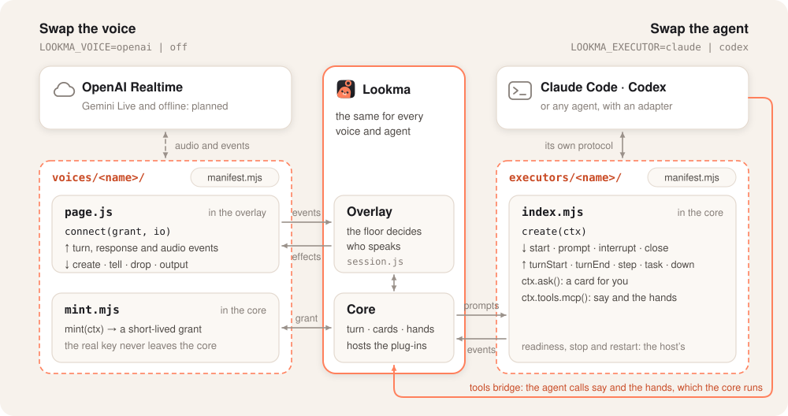

# Writing a voice

> **Provisional.** This interface is drawn from one provider, OpenAI Realtime. The second provider (Gemini Live is next) may change it, and this guide will change with it.

A voice is the assistant you talk to: one conversational voice service, such as OpenAI Realtime. Adding one takes one folder, `voices/<name>/`. This guide walks through it. The exact shapes are in [protocol.md](protocol.md#voice-provider-contract) and `overlay/voice/contract.js`.

## What a voice is

<picture>
  <source media="(prefers-color-scheme: dark)" srcset="images/plug-ins-dark.svg">
  /: page.js in the overlay connects to the voice service, emits voice events and carries out the effects the floor and the turn source ask for, and mint.mjs in the core mints a short-lived grant, so the real key stays in the core. On the right, the agent plug-in.">
</picture>

A provider has two halves, and decides nothing:

- **`page.js`**, in the overlay, connects to the service. It turns what the service sends into **voice events** in Lookma's own words (`turn.*`, `response.*`, `audio.*`), and carries out the six **effects** Lookma asks for (`create`, `tell`, `drop`, `output`, `listen`, `cut`).
- **`mint.mjs`**, in the core, mints a short-lived **grant** for each session, so the real API key never leaves the core.

Everything else is the same for every provider:

- **The floor** (`overlay/voice/floor.js`) decides who speaks: one reply at a time, user turns first, then what the work wants said. It asks for every reply. It is a pure function of the voice events, and it never sees a service's own event names.
- **The turn source** (`overlay/voice/source.js`) decides whether the microphone is open and who ends the turn: `off`, `auto` (your provider finds the turns) or `hold` (the user holds a key). It tells your page with `listen`, and stops the butler by hand with `cut`.
- **The session** (`overlay/voice/session.js`) owns the lifecycle: the microphone device, the grant, the connect deadline, reconnecting with backoff, renewing while idle, pause.
- **The voice host** (`core/voice/host.mjs`) loads your provider, reads the butler's prompts and calls `mint` for each `POST /api/voice/grant`.

## The folder

```
voices/<name>/
  manifest.mjs     what it needs: title, settings, checks
  mint.mjs         mint(ctx), in the core
  page.js          connect(grant, io), a browser module, no build step
  page/            optional: more browser modules page.js imports
  dev/fake.mjs     a stand-in for the service, for the voice check
  dev/check.mjs    optional: checks of your own parts; npm test runs it
```

`<name>` is lowercase letters and digits with single hyphens, unique across voices and executors, and what people type: `LOOKMA_VOICE=<name>` or `lookma --voice <name>`. The core serves only `page.js` and `page/*` to the overlay, at `/voices/<name>/`; nothing else in the folder leaves the core.

The manifest is the same as an executor's ([Writing an executor](writing-an-executor.md#the-manifest)). Settings are named `LOOKMA_<NAME>_<KEY>`, and an API key is declared like this, so the loader finds it missing, the doctor says so, and no other plug-in's processes ever see it:

```js
// voices/openai/manifest.mjs
export default {
  title: 'OpenAI Realtime',
  settings: {
    apiKey: { default: '', env: 'OPENAI_API_KEY', secret: true, required: true, help: 'turns on voice; without it you type instead' },
    model: { default: 'gpt-realtime-2.1', help: 'the voice model' },
    voice: { default: 'marin', help: 'the voice it speaks with' },
  },
}
```

A voice whose required setting is unset does not stop Lookma: it runs without voice, with captions and typed requests, and `lookma doctor` says why.

## `mint(ctx)`: the grant

```js
// voices/<name>/mint.mjs
export async function mint({ options, instructions, tools, audio, language, log }) {
  return { credential, startBy, renewAfter, label, session }
}
```

| Input | |
|---|---|
| `options` | your settings, checked; the API key among them |
| `instructions` | the butler's prompt, `prompts/butler.md`, read for every grant |
| `tools` | the butler's tools, `prompts/butler-tools.json`: `[{ name, description, parameters }]` (`do`, `status`, `answer`, `control`, `pass`) |
| `audio` | `room` or `headset` (`LOOKMA_AUDIO`), see below |
| `language` | what the user speaks, an ISO 639-1 code, or `''` to detect it |

| Output | |
|---|---|
| `credential` | what the page connects with: an ephemeral key or a token, **never the real key**. Leave it out if the service needs none |
| `startBy` | epoch ms: no connection may start with this grant after it. The session mints a renewal's grant a minute ahead and uses it only if `startBy` is still far enough away |
| `renewAfter` | ms after which the session is swapped for a fresh one at the next idle moment. Set it below the service's session limit (OpenAI: 50 min of 60) |
| `label` | for the log line `voice: connected (<label>)`, e.g. the model |
| `session` | anything your `page.js` needs, opaque to everyone else (OpenAI: the parameters of each kind of reply, and the turn detection to restore after a hold) |

Set the session up here, once, wherever the service lets you: OpenAI's key carries the butler's instructions, tools, transcription and turn detection, so the page never builds a session. A `mint` that throws is a 502: the page tries again later.

## `connect(grant, io)`: the page half

```js
// voices/<name>/page.js
import { item } from '/voice/contract.js'

export async function connect(grant, io) {
  // ... open the connection with grant.credential, hearing nothing; release everything when io.signal aborts
  // ... on each service message: io.onEvent(voiceEvent)
  // ... when it ends by itself: io.onClose('why')
  return { send(effect) { /* one of the six effects; listen brings the microphone */ } }
}
```

- **`connect`** resolves once the connection is live, and rejects in words. It hears nothing yet: the microphone arrives with the first `listen`. The session gives it 15 s, then tries again with backoff.
- **`io.signal`** aborts when the session ends the connection, live or still coming up: close it and release everything at once. From then on the session ignores this connection, so you never need to check whether you are still current.
- **`io.onEvent(event)`** for each voice event, **`io.onClose(why)`** once, when the connection ended by itself (the service hung up, the network failed). The session reconnects.
- **`send(effect)`** is called only while the connection is live, with one of the six effects and nothing else.

`overlay/voice/contract.js` is the only code you share with the floor: `item()` turns a model output into the floor's terms (a message, a call with parsed arguments, or `pass`, the butler's "this was not for me"), and its typedefs list every event and effect.

## The events you must emit

**You find the turns in `auto`; in `hold` the key does.** In `auto`, the service's own detector or one in your page: the floor only needs to know when a user turn began and when it is complete. The floor's rules rest on these being true:

| Event | Your obligation |
|---|---|
| `turn.started { id }` | As soon as the user is audibly speaking. One id per user turn: the service's, or one you mint. The floor will not start a reply while it hears the user |
| `turn.stopped { id }` | The user's speech stopped |
| `turn.committed { id }` | The turn is complete and in the conversation |
| `turn.dropped { id }` | A turn that began and will never be committed (a `listen` ended it before it was complete). A begun turn always ends, committed or dropped |
| `turn.transcript { id, text \| null }` | Once per committed turn: its transcript, or `null` when there is none. The approval check reads it |
| `response.started { response }` | Once per reply you began for a `create`, before its other events |
| `response.item { response, kind }` | As soon as the reply's first output is known to be a message, a call or a `pass` (`item()` gives the kind) |
| `butler.said { response, text, final }` | What the butler is saying, as it says it, then whole with `final: true`: for captions and approval evidence |
| `response.done { response, status, items, reason? }` | `completed`; `cancelled` (cut by the user, or by the client); `failed`; or `incomplete`. `items` through `item()` |
| `audio.started / audio.stopped / audio.cleared { response }` | The truth about playback **at the speaker**: started, played to the end, cut off. If your page plays the audio itself, report your own player, not the service |
| `error { eventId, message }` | `eventId` of the `create` the service rejected, when it can tell; `null` otherwise |

A reply's announcement counts as heard only after `audio.stopped`: report it early and the user is told something is spoken that never was.

## The six effects

| Effect | Means | Nearest behaviour when the service lacks it |
|---|---|---|
| `create { kind: 'turn', eventId }` | Start one reply now, covering everything in the conversation, with tools allowed. The service must **never** reply by itself: every reply is a `create` | Required. Hold the service's own trigger until `create` arrives |
| `create { kind: 'speak', eventId }` | Start one reply now that only speaks | Start an ordinary reply. The floor never runs a speak reply's calls and voids them |
| `tell { texts }` | Add these texts to the conversation, as things the butler was told. No reply | Required |
| `drop { items }` | These items are void: remove them from the conversation if you can. A void item that is a call still waiting for its result is resolved silently | Resolve the calls silently, and leave the rest |
| `output { results: [{ callId, output }] }` | The results of the butler's calls. No reply: the floor asks for that | Required |
| `listen { how: 'off' }` | Send no audio and begin no turn. The microphone is no longer yours: the session closes it. A turn begun and not committed ends now: `turn.committed`, or `turn.dropped` | Required: not sending audio is always possible |
| `listen { how: 'auto', mic }` | Hear `mic` (a MediaStream) and find the turns | Required |
| `listen { how: 'hold', mic }` | Hear `mic`; the user holds the turn by hand, so do not end it yourself. The next `listen` ends it: `turn.stopped`, then `turn.committed`, or `turn.dropped` when it held no audio; with `drop: true` on that `listen`, discard it and emit `turn.dropped` | Hear `mic` as `auto`: your detector ends the turn a moment after the user lets go |
| `cut` | The user stopped the butler by hand. Two independent parts: if a reply is still being made, cancel it (`response.done` `cancelled`); if the butler is at the speaker, silence it now and emit `audio.cleared`. Audio outlasts the reply that made it, so neither implies the other | Silencing is required: mute your own player if the service cannot clear. Cancelling: let the reply finish unheard |

`listen` is a level, not an edge: it comes on every change and once after each connect, so a repeat of the current one changes nothing, and a new connection never needs to be told history.

**When the service cannot.** Nothing is declared and nothing is checked at run time. The effects are defined so that the nearest behaviour is always safe, and rules the floor already has absorb the difference. A provider with such limits says so in a "Limits" paragraph in its section of protocol.md.

| The service cannot | What your provider does | Why it still works |
|---|---|---|
| Delete conversation items | `drop` only resolves pending calls silently | The floor settles a declined turn in its own state; only the model's context keeps the noise |
| Restrict a reply to speech | `create { speak }` starts an ordinary reply | The floor never runs a speak reply's calls. One that produced only a call fails, is retried, and after two failures is shown on screen |
| Match an error to a `create` | Emit `error` for the outstanding `create` on any connection-level error | Every reply has a deadline (`SLOT_MS`), after which it fails; failures are bounded |
| Let the user's voice cut a reply | Behave as `room`, whatever `audio` says | The floor's rule for a cut reply simply never fires |
| Take manual turns | Hear a `hold` as `auto` | The key still opens the microphone and cuts the butler; release closes it, and the service's detector ends the turn a moment later |

## `room` and `headset`

`audio` in `mint`'s input says how the user hears the voice. One model covers both; it is only two settings of your service:

- **`room`** (the default, speakers): the butler's voice comes back through the microphone, so the user's voice never cuts a reply; it finishes its sentence. Noise reduction for a far microphone. OpenAI: `interrupt_response: false`, `far_field`.
- **`headset`**: talking over the butler cuts it off at once (barge-in): stop the audio, emit `audio.cleared`, and end the reply `cancelled`. Noise reduction for a near microphone. OpenAI: `interrupt_response: true`, `near_field`.

## What rules a service out

A Lookma voice is a whole conversational voice: it hears, decides with the butler's prompt and tools, and speaks. A service cannot be a Lookma voice if it:

- **cannot report playback truthfully** (when the user really started and stopped hearing a reply): the floor settles what is owed on that, and approvals rely on knowing whether the butler was audible; or
- **cannot hold its reply until asked**: a service that always answers by itself would answer the TV, and talk over the work's announcements.

Everything outside the "When the service cannot" table is mandatory.

## The voice check

`node overlay/dev/check-voices.mjs` runs the real overlay, the real session and floor and your real `page.js` in headless Chrome, once per folder in `voices/`, against your `dev/fake.mjs`. It plays user turns, replies, audio, drops and pauses in as voice events, and reads back the effects your page sent. Then it drives your `connect` on its own with `listen` and `cut`, as the turn source would: a hold from `off` and from `auto`, a tap's dropped hold, a refused commit, a cut while a reply is made and while it plays. Nothing reaches the network. The fake exports:

| Export | |
|---|---|
| `grant` | a grant as your `mint` returns it, without `startBy` (the check adds one) |
| `page` | a script the check runs in the page before it loads: it replaces your transport (OpenAI: `RTCPeerConnection` and the SDP `fetch`) with a fake service, and defines `window.__fake` with `connections` (one `{ tracks, closed }` per connection; `tracks` every track put on its sender, `null` for one taken off: OpenAI records `replaceTrack`), `sent` (every message your page sent, as `{ connection, event }`), `emit(messages)` (plays service messages in, on the newest connection) and `drop()` (the newest connection closes by itself) |
| `toService(event)` | a scripted voice event as the service messages that carry it. `response.item` and `response.done` carry whole items (`{ item }`, `{ items }`) with their ids, and a call's `args` are an object |
| `fromService({ connection, event })` | one message your page sent, as the effect it carries (`{ type: 'tell', texts: [text] }`, ...) plus its `connection`. A message that is a step of a `listen` or a `cut` is `{ type: 'listen' \| 'cut', step }`: `detect` (detection back on, with `detection`), `undetect`, `discard` (buffered input cleared), `commit` (with `eventId`), `cancel`, `silence`. Anything else is `{ type: 'other', event }`. The steps are drawn from OpenAI, like the rest of this interface |

`voices/openai/dev/fake.mjs` is the complete example. Put checks of your own parts in `dev/check.mjs` (OpenAI's checks the session it would mint, without a call). `check-voices.mjs` needs Google Chrome; `npm test` runs your `dev/check.mjs`.

## Worked mappings

### OpenAI Realtime (`voices/openai/`, real)

One WebRTC call per session: the call's audio sender starts with no track and `listen` puts the microphone on it, the butler's voice plays on an `<audio>` element, and the events run on the `oai-events` data channel. Server voice activity detection finds the turns in `auto`; in `hold` the page switches it off and commits the turn itself at release.

| Lookma | OpenAI Realtime |
|---|---|
| `mint` | `POST /v1/realtime/client_secrets` with the whole session baked in: instructions, tools, `semantic_vad` with `create_response: false`, transcription, noise reduction, voice, `max_output_tokens`. `startBy` is the key's `expires_at`, `renewAfter` 50 min; `session` carries the reply parameters and the minted `turn_detection` |
| `turn.started / stopped / committed` | `input_audio_buffer.speech_started / speech_stopped / committed`, by `item_id` |
| `turn.transcript` | `conversation.item.input_audio_transcription.completed`, or `.failed` as `null` |
| `response.started`, `response.item` | `response.created`, `response.output_item.added` |
| `butler.said` | `response.output_audio_transcript.delta`, then `.done` as `final` |
| `response.done` | `response.done`, its `status` and `output` |
| `audio.started / stopped / cleared` | `output_audio_buffer.started / stopped / cleared` |
| `error` | `error`, with its `event_id` |
| `create` | `response.create` with the grant's parameters for that kind (`speak`: `tool_choice: 'none'`), never instructions |
| `tell` | `conversation.item.create`, a user message per text |
| `drop` | `conversation.item.delete` per item |
| `output` | `conversation.item.create`, a `function_call_output` per result |
| `listen` | `sender.replaceTrack(mic track)`, or `replaceTrack(null)` for `off`; `off` with a VAD turn open: `input_audio_buffer.clear`, then `turn.dropped`. `hold`: `session.update` with `turn_detection: null`; from `off` also `input_audio_buffer.clear` and `turn.started` under the page's own id; from `auto` a VAD turn already open is adopted. Leaving `hold`: `turn.stopped`, then after 150 ms `input_audio_buffer.commit` (with `drop`: `input_audio_buffer.clear`, `turn.dropped`). `auto` after a hold: `session.update` with the minted detection |
| turn ids | A held turn's server `item_id`, where it differs from the page's id, is an alias: transcripts come in and `drop` goes out under the one id the floor knows |
| `cut` | `response.cancel` while a reply is being made, `output_audio_buffer.clear` while its audio plays, each independently |

### Gemini Live (design only, not built, not verified)

How the second provider is expected to map, to show the interface fits a differently shaped service. Every row needs a live check first.

| Lookma | Gemini Live |
|---|---|
| `mint` | An ephemeral token (`POST /v1beta/auth_tokens`) with the session locked in its connect constraints; `startBy` its `newSessionExpireTime`; `renewAfter` below Gemini's shorter session limit |
| transport | A WebSocket; 16 kHz PCM captured from the `listen` effect's `mic` in an AudioWorklet; a PCM player in the page, which reports its own `audio.*` |
| `listen`, `cut` | `listen hold` = `activityStart` at once, `activityEnd` held until the floor's `create` as for any turn; `listen off` = stop the worklet; `cut` = stop the page's own player and report `audio.cleared` |
| turn detection | In the page: automatic activity detection off, a local voice activity detector sends `activityStart` (`turn.started`) and marks the end (`turn.committed`). `activityEnd` is sent only when the floor's `create { kind: 'turn' }` arrives, so the service replies only when asked |
| `create { speak }`, `tell` | `clientContent` with `turnComplete: true`, and with `turnComplete: false` |
| `output` | `toolResponse`; a `pass` call is answered silently |
| `room` / `headset` | `activityHandling: NO_INTERRUPTION` / `START_OF_ACTIVITY_INTERRUPTS` |
| Limits | cannot delete items, cannot restrict a reply to speech, cannot match an error to a `create`: the first three rows of "When the service cannot" |

The open question is echo cancellation of WebAudio playback inside the app's WKWebView in `room`.

## Ship it

1. `LOOKMA_VOICE=<name> lookma doctor` shows your settings and whether the voice is on.
2. `npm run check && npm test`, and `node overlay/dev/check-voices.mjs` with your fake.
3. Try it live: `lookma --voice <name> ~/Projects`. A live voice session costs money on most services: keep live checks few, and behind `LOOKMA_LIVE_TESTS=1` if they are scripted.
4. Add a section for your provider to [protocol.md](protocol.md#voice-provider-contract) like the OpenAI one, with its limits if it has any, and its settings to the README's Configuration table.
