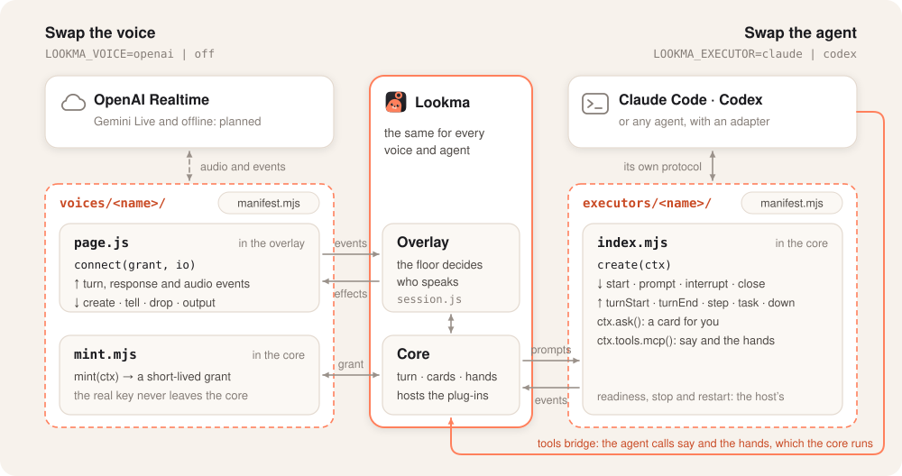

# Writing an executor

An executor is the agent that does the work: Claude Code and Codex ship today. Adding one takes one folder, `executors/<name>/`, and nothing in the core. This guide walks through it. The exact rules are in [protocol.md](protocol.md#executor-contract); where the two differ, protocol.md wins.

## What an executor is

<picture>
  <source media="(prefers-color-scheme: dark)" srcset="images/plug-ins-dark.svg">
  /: index.mjs in the core drives the agent with start, prompt, interrupt and close, and reports turnStart, turnEnd, step, task and down. The agent calls say and the hands through the tools bridge, which the core runs. On the left, the voice plug-in.">
</picture>

Your adapter is a driver for one agent session. It only translates: prompts and an interrupt go down to the agent, and the agent's activity comes up as five events. Everything else is Lookma's:

- **The core** owns the user's turn, the cards, the outbox and the screen.
- **The executor host** (`core/executor/host.mjs`) is the only code that loads your adapter. It owns readiness, the order of prompts, the stop gate and one restart, the same way for every agent.
- **The tools bridge** (`core/executor/bridge.mjs`) is a stdio MCP server your agent spawns. It gives the agent `say` and the six hands tools, and the host serves every call. Your adapter never touches the screen or the voice.

So your adapter never sees a socket, a card id, a port or another plug-in's secret.

## The folder

```
executors/<name>/
  manifest.mjs         what it needs: title, settings, checks
  index.mjs            create(ctx), the adapter
  ...                  anything else it imports
  dev/fake-agent.mjs   a stand-in for the agent, for the conformance check
  dev/check.mjs        optional: checks of your adapter's own parts; npm test runs it
```

`<name>` is lowercase letters and digits with single hyphens, and unique across executors and voices. It is what people type: `LOOKMA_EXECUTOR=<name>` or `lookma --agent <name>`.

## The manifest

```js
// executors/codex/manifest.mjs, shortened
import { ok, fail, sh, atLeast } from '../../core/doctor.mjs'

function checkCodex() {
  const v = sh('codex', ['--version'])
  if (!v.ok) return fail('Codex CLI (codex) is not on PATH', 'npm install -g @openai/codex')
  // ... version, login
  return ok(`Codex ${version}, logged in`)
}

export default {
  title: 'Codex',
  settings: {
    model: { default: '', help: "the Codex model; empty, Codex's default" },
    fast: { default: false, help: "1: Codex's Fast speed tier" },
  },
  checks: [checkCodex],
}
```

- **`title`** is the name people read in `lookma doctor`, `lookma --help` and the log ("Codex stopped responding").
- **`settings`** reach your adapter as `ctx.options`, already parsed and checked. You never write a setting's name: it is derived, `LOOKMA_<NAME>_<KEY>`, so `codex` + `model` is `LOOKMA_CODEX_MODEL` and `claude` + `permissionMode` is `LOOKMA_CLAUDE_PERMISSION_MODE`. A setting is `{ default, help, env?, secret?, required? }`. Its type is the type of `default`: a string, a number, or a boolean written `1` or `0`. `env` names a well-known variable instead (Codex reads `CODEX_HOME`). `secret` is never printed and is kept out of other plug-ins' environments. `required` stops `lookma start` while the setting is unset.
- **`checks`** are functions `options => finding`, run by `lookma doctor` and before every start. Return `ok(text)`, `warn(text, fix)` or `fail(text, fix)`. Check what your agent needs: the binary on `PATH`, a version, a login. Say which login and who pays, as the Claude Code check does.
- A manifest imports only Node's own modules and the helpers in `core/doctor.mjs` (`ok`, `warn`, `fail`, `sh`, `atLeast`), because `lookma doctor` reads it before `npm install`. `core/plugins.mjs` is the only code that reads it, and it says exactly what is wrong with a malformed one.

`lookma --help` and `lookma doctor` list your settings with no work on your part. Add them to the README's Configuration table too.

## `create(ctx)`

```js
// executors/<name>/index.mjs
export function create(ctx) {
  return {
    async start({ dirs }) {},   // resolves when the agent can take a prompt and call its tools
    async prompt(text) {},      // resolves when the agent has taken the message
    async interrupt() {},       // resolves when the agent is idle and nothing of the stopped work follows
    async close() {},           // resolves when every process of the session has ended
  }
}
```

`create` has no side effects. The host calls `start` once, then `prompt` and `interrupt` any number of times, and `close` at the end. After a `close` it may call `start` again: that is its restart.

| Method | The promise you keep |
|---|---|
| `start({ dirs })` | Resolves only when a prompt would be taken **and** your agent is connected to its tools (each agent's protocol says so: an MCP status, an init message). Rejects in words ("Codex exited (1)."): the user reads it. `dirs` are the folders the user passed, the only ones the agent may write in. Whether a restart resumes the old conversation is your business: Claude Code resumes it by session id, Codex starts a fresh thread. |
| `prompt(text)` | Delivers one message from the user and resolves once the agent has taken it, **not** when the work is done. Rejects if the agent refused it (a usage limit, say); the host then fails the turn with your error. |
| `interrupt()` | Stops the current work. Resolves only when the agent is idle and nothing of the stopped work will be emitted or called any more. With nothing running, it resolves at once. |
| `close()` | Ends the session and every process it started. Emits nothing: `down` is only for a session that died by itself. |

`ctx` is all you get:

| | |
|---|---|
| `emit(event)` | the five events below |
| `tools.server`, `tools.mcp(extras?)` | the tools' MCP server name (`lookma`) and the spawn spec of the tools bridge |
| `ask({ title, detail }, signal?)` | a card for the user: `true`, `false`, or `null` when withdrawn |
| `options` | your settings, from your manifest, checked |
| `instructions` | the text of `prompts/executor.md`: give it to the agent as its system or developer prompt |
| `sessionDir` | `<data>/sessions/<name>`, created and yours to fill (a working folder, a config home) |
| `env` | the environment for your child processes: the user's, without other plug-ins' secrets |
| `log(...)` | a line in the core's log, prefixed with your name |

## The five events

```js
{ type: 'turnEnd', ok, summary?, error? }   // the agent became idle
{ type: 'step', title }                     // a step of the main work that is not on screen
{ type: 'turnStart' }                       // the agent became busy without a prompt from the core
{ type: 'task', id, title, status, action?, result? }   // background work
{ type: 'down', detail }                    // the session died by itself
```

- **`turnEnd`**, once each time the agent goes idle. `ok: false` with an `error` in words when it failed: the user hears "That did not work" with your reason. `summary` is the agent's final text, for the log only. A prompt that joined the running work does not get its own `turnEnd`.
- **`step`** for each tool call of the main work that has nothing on screen: reading a file, running a command, searching the web. The capsule shows it as its status line. Take the title from `core/executor/steps.mjs`, `title(kind, detail)` (`read`, `list`, `search`, `web`, `run`, `write`, `edit`, `delete`, `task`, `tool`), so every agent's steps read alike. Never for calls to `ctx.tools.server`: the hands show themselves on screen.
- **`turnStart`** only for work the core did not start, such as a background task waking the agent up. Never for a prompt you just delivered.
- **`task`** only if your agent runs background work (Claude Code's subagents): `status` is `running`, `done` or `failed`, `action` the step it is on, and `result: { speech, display }` the report the voice reads when it is done.
- **`down`** once, when the agent exited or its connection broke by itself. During `start`, reject the start instead.

An agent without background work never emits `turnStart` or `task`. Nothing is declared: an event you never emit is simply never seen.

## Giving the agent its tools

```js
const spec = ctx.tools.mcp()   // { command, args, env }
```

`ctx.tools.mcp()` returns the spawn spec of a stdio MCP server. Hand it to your agent as one of its MCP servers, named `ctx.tools.server`, and the agent gets `say` and the hands. Pass the spec's `env` only to that server, not to the agent. `extras` adds what one agent's MCP client wants: `toolMeta`, merged into each tool's `_meta` (Claude Code passes `{ 'anthropic/alwaysLoad': true }`), and `instructions`, the server's MCP instructions.

Never give the agent another way to touch the screen. The hands are what makes every step visible, granted per app and stoppable: turn off your agent's own computer use or browser control.

## Asking the user

```js
const allow = await ctx.ask({ title: 'Run this command?', detail: 'npm test' })
```

Map each permission request of your agent to one card, and answer the agent with the result:

- `true` is a yes **for this request only**. Never map it to an "always allow" or "for this session" option, even when the agent offers one.
- `false` is a no; `null` means the card was withdrawn (a stop, a restart, `close`). Answer both with your agent's deny or cancel.
- `title` is a short question; `detail` shows what the step would do (the command, the file, the page), never the agent's own options.
- If your agent can close a request by itself (an interrupt does that in Claude Code), pass an `AbortSignal` as the second argument and abort it then: the card goes away.

The host withdraws every open card at a stop, so you never track card ids.

## Steering and interrupt

These are the two promises adapters get wrong.

**A prompt during work joins the work.** `prompt` while the agent is busy means: add this to what you are doing, as soon as you can. The user is correcting or adding to the request ("no, the other one"). It must never restart the conversation and never be lost. Claude Code and Codex take a message mid-turn natively. If your agent cannot, interrupt it yourself and send the text as the next prompt in the same conversation, without a `turnEnd` for that inner interrupt.

**`interrupt` resolves on the truth.** Resolve when the agent has stopped, not when you sent the request. The host closes a **stop gate** when it calls `interrupt()` and opens it when your promise resolves. While it is closed, your events are dropped, tool calls are refused and cards are withdrawn, so nothing of the stopped work reaches the user or the screen. After it opens, an event belongs to the next turn. So:

- Resolve too early, and a late `turnEnd` of the stopped work ends the user's next turn.
- Never resolve, and after 10 s the host treats the session as broken: it fails the turn, calls `close()` and `start()` again. A second failure within a minute leaves the executor `down` until Lookma restarts. A `down` event takes the same path.
- An interrupt can arrive while a prompt is still being delivered. Wait for that delivery first, or the turn it starts escapes the stop (the Codex adapter keeps the delivery's promise for this).

## Isolation

Lookma runs your agent beside the user's own use of it. The session must not pick up the user's setup, and must not leak into it:

- **Its own config home** in `ctx.sessionDir` (Codex: `CODEX_HOME` with only a link to the login), or flags that skip the user's settings (Claude Code: no setting sources).
- **No user MCP servers, plugins or hooks.** Only `ctx.tools.mcp()`.
- **An empty working folder** in `ctx.sessionDir`, so no project instructions are read, and **write access only to `dirs`**.
- **`ctx.env`** for every child process, so the voice's API key is never passed on.
- **The agent's own question tool off**, if it has one: the user answers by voice or card, so the agent asks with `say`.

## The conformance check

`core/dev/check-executors.mjs` runs one list of scenarios over every folder in `executors/`, with the real host, your real adapter and the real tools bridge. The agent is replaced by your `dev/fake-agent.mjs`: a small script that speaks your agent's protocol, exports `bin` (the command your adapter spawns; the check puts a script by that name first on `ctx.env`'s `PATH`), and plays each prompt as a command:

| Prompt | The fake |
|---|---|
| `say <words>` | calls `say` through the bridge, then ends the turn ok with `<words>` as its summary |
| `see` | calls `see`; ends ok with the result's text as its summary |
| `ask` | asks a permission; ends ok with the summary `yes` or `no` |
| `fail` | ends the turn failed, with the error `boom` |
| `refuse` | refuses the prompt itself (an error about a usage limit) |
| `work` | takes a step, then works until interrupted; a prompt meanwhile ends the turn ok with the summary `steered: <prompt>` |
| `stuck` | takes a step, then ignores everything, interrupts included |
| `die` | exits at once |

Interrupted, the stopped work straggles: it says `late` and takes one more step before its turn ends, and the check proves the gate held both back. It also checks readiness, cards allowed, declined and withdrawn, the restart after `stuck` and `die`, and that `close` leaves no process. `npm test` runs it, offline. The fakes in `executors/claude/` and `executors/codex/` are complete examples.

## A complete minimal adapter

`mini-agent` is a made-up agent that speaks JSON lines on stdio:

- Requests from the adapter carry an `id`, and the agent answers each with `{ id, ok, error? }`: `session` (with `dirs`, `instructions` and `mcp`, its MCP servers) is answered once the agent is connected to them; `message` once it has taken the text, also mid-turn; `interrupt` once it is idle.
- The agent sends `{ event: 'tool', server, name }` for each tool call, `{ event: 'permission', ask, title, detail }` for a permission, answered with `{ method: 'answer', ask, allow }`, and `{ event: 'done', ok, text, error }` when a turn ends.

This adapter, with a manifest `{ title: 'Mini agent', settings: {} }` and a fake that speaks the same protocol, passes the whole conformance check:

```js
// executors/mini/index.mjs: the adapter for mini-agent, which speaks JSON lines on stdio.
import { spawn } from 'node:child_process'
import readline from 'node:readline'
import { title as stepTitle } from '../../core/executor/steps.mjs'

export function create(ctx) {
  let agent = null // the running mini-agent
  let closing = false
  let seq = 0
  const waiting = new Map() // request id -> { resolve, reject }

  const write = (to, msg) => to.stdin.write(JSON.stringify(msg) + '\n')

  // A request the agent answers with { id, ok, error? }.
  function request(method, params = {}) {
    const id = ++seq
    write(agent, { id, method, ...params })
    return new Promise((resolve, reject) => waiting.set(id, { resolve, reject }))
  }

  const EVENTS = {
    tool({ server, name }) {
      // The hands show themselves on screen; any other tool is a step.
      if (server !== ctx.tools.server) ctx.emit({ type: 'step', title: stepTitle('tool', `${server} · ${name}`) })
    },
    async permission({ ask, title, detail }, from) {
      const allow = await ctx.ask({ title, detail }) // null: withdrawn, answered as a no
      if (from === agent) write(from, { method: 'answer', ask, allow: allow === true })
    },
    done({ ok, text, error }) {
      ctx.emit({ type: 'turnEnd', ok, summary: text, error })
    },
  }

  // The agent's output is a boundary: a line that is not what the protocol says is logged and skipped.
  function receive(from, line) {
    let msg
    try {
      msg = JSON.parse(line)
    } catch {
      return ctx.log('not JSON:', line)
    }
    const waiter = waiting.get(msg.id)
    if (waiter) {
      waiting.delete(msg.id)
      return msg.ok ? waiter.resolve() : waiter.reject(new Error(msg.error))
    }
    if (EVENTS[msg.event]) return EVENTS[msg.event](msg, from)
    ctx.log('unknown message:', line)
  }

  function exited(code) {
    for (const waiter of waiting.values()) waiter.reject(new Error(`mini-agent exited (${code})`))
    waiting.clear()
    agent = null
    if (!closing) ctx.emit({ type: 'down', detail: `mini-agent exited (${code})` })
  }

  return {
    async start({ dirs }) {
      closing = false
      const me = (agent = spawn('mini-agent', ['--stdio'], { cwd: ctx.sessionDir, env: ctx.env, stdio: ['pipe', 'pipe', 'inherit'] }))
      readline.createInterface({ input: me.stdout }).on('line', line => receive(me, line))
      me.on('exit', exited)
      // Answered once the agent can take a message and has connected to its tools.
      await request('session', { dirs, instructions: ctx.instructions, mcp: { [ctx.tools.server]: ctx.tools.mcp() } })
    },
    prompt: text => request('message', { text }),
    interrupt: () => request('interrupt'),
    async close() {
      if (!agent) return
      closing = true
      const gone = new Promise(resolve => agent.once('exit', resolve))
      agent.kill()
      await gone
    },
  }
}
```

What it shows:

- `start` resolves on the agent's own "ready, tools connected", and an agent that exits during the start rejects it, because `exited` rejects every waiting request.
- `interrupt` is as simple as the agent's protocol allows: this agent answers only once it is idle. If yours answers at once, wait for the stopped turn's end as well, as the Codex adapter does.
- A permission is answered only to the agent that asked: after a restart, an old card's answer has nowhere to go.
- It emits no `turnStart` or `task`, since this agent has no background work.

A real adapter adds isolation (its own config home, no user MCP servers), its agent's step kinds, and a richer card per kind of request.

## Ship it

1. `LOOKMA_EXECUTOR=<name> lookma doctor` shows your manifest's settings and checks.
2. `npm run check && npm test` runs the conformance check over your adapter and your `dev/check.mjs`.
3. Try it live with text only: `lookma --agent <name> --voice off ~/Projects`, then type, or post to `/api/tell`.
4. Add a section for your adapter to [protocol.md](protocol.md#executor-contract) like the Codex one (how it runs, isolation, start, turns, cards), and its settings to the README's Configuration table.
